# <center>Holmes2026-2 - Bottle Out - Writeup</center>

-----------

<p align="center">
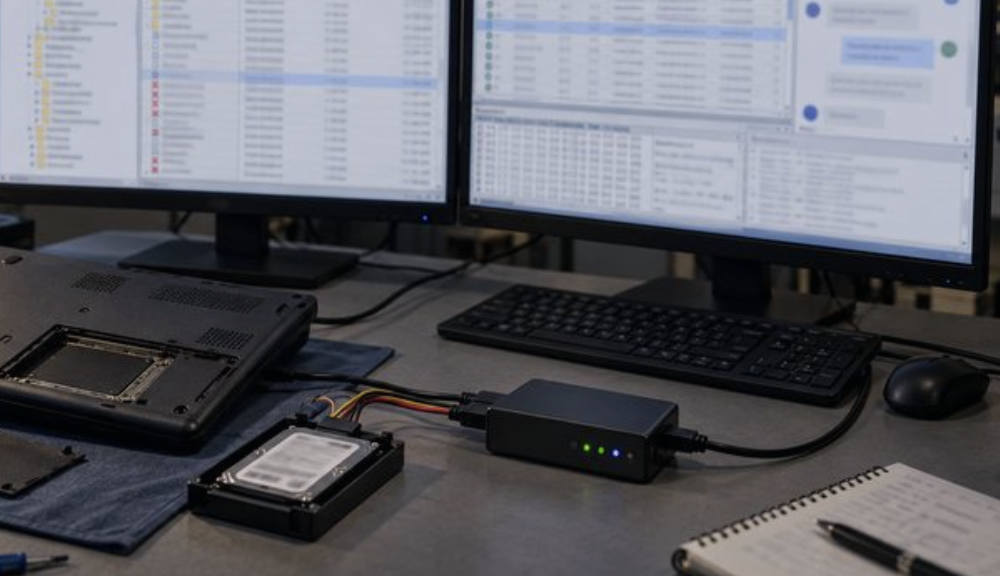
</p>

2026-09-01

Prepared by: achille

Sherlock Author: achille

Difficulty: <font color="green">Easy</font>

## Scenario

```
Holmes finds Watson, who is battered and still dazed, but alive. However, there is one extremely significant detail: whoever was holding him prisoner must have fled in a rush, as they left a computer switched on and unlocked on the work surface. Holmes immediately makes a forensic copy of the computer and transfers it to his own machine to analyze and extract as much information as possible.
```

## Artifacts Provided

Spawn the VM and connect to it using the following credentials: `Administrator:Holmes2026!`

## Skills Learnt

* Windows DFIR
* Browser Forensics
* Deleted Data Recovery

## Initial Analysis

----------

We spawn the VM that is preconfigured for the analysis and we can immediately see that in the Desktop there is a **.E01** file named `DESKTOP-QMTIG5I.E01`.

**E01** is a forensic disk image format commonly used to preserve a bit-for-bit copy of a storage device while maintaining forensic metadata and integrity information. It can be opened using a forensic tool such as:

- **FTK Imager**
- **Autopsy**
- **EnCase**

We proceed by using **Autopsy**, so we fire it up and load the .E01 file inside it. Once the analysis is completed we can start to investigate the case.

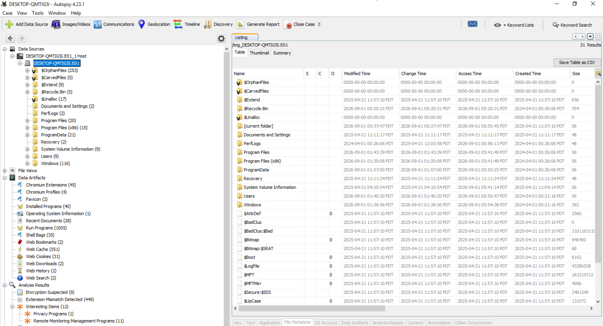

The root of the Windows filesystem is visible, including several important forensic directories such as `$OrphanFiles`, `$Recycle.Bin`, `$Extend`, `$Unalloc`, `Users`, `Windows`, `Program Files`, and `ProgramData`.

Of particular interest is **`$OrphanFiles`**, which contains files whose filesystem metadata indicates they are no longer associated with a normal directory entry. These can be particularly valuable during forensic investigations, as they may contain remnants of **deleted or otherwise disconnected files** that are no longer visible through the normal Windows directory structure.

Autopsy has also automatically identified a number of relevant **data artifacts**, including:

- **Chrome artifacts**:  extensions, profiles, cookies, history, web cache, and downloads.
- **Installed Programs**: applications installed on the system.
- **Recent Documents**: recently accessed files.
- **Run Programs**: evidence of programs executed on the system.
- **Shell Bags**: evidence of folders and directories accessed through Windows Explorer.
- **Web Bookmarks, History and Search**: browser activity.
- **Encryption Suspected**: files that Autopsy believes may contain encrypted data.
- **Remote Monitoring Management Programs**: potentially relevant remote-access and management software.

The image also contains standard **NTFS metadata files**, including `$MFT`, `$LogFile`, `$UsnJrnl`, `$Secure`, and `$Bitmap`. These can provide additional evidence regarding file creation, modification, deletion, and other filesystem activity.

If we expand the `Installed Programs` results we can see some intersting software that was available in the system, for example:

- OpenVPN v.2.7.601
- Tactical RMM Agent v.2.11.0
- Edge Browser
- Chrome Browser

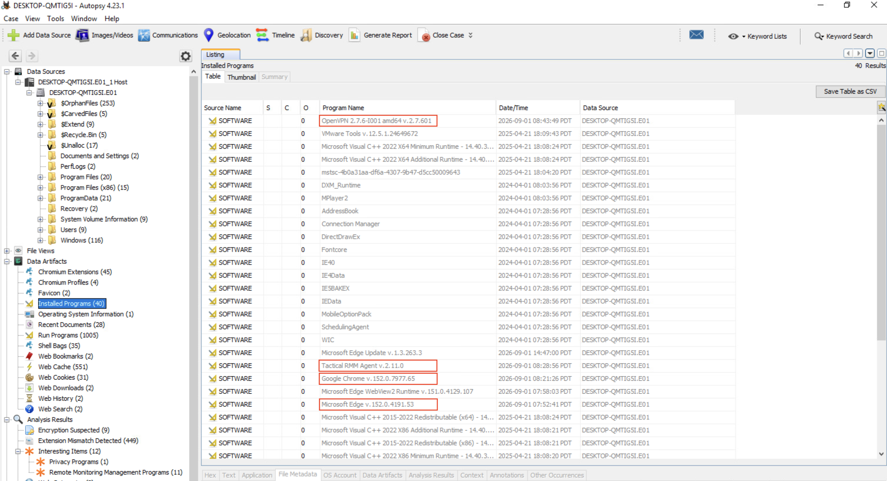

We know that the **OpenVPN** was installed, we can search for traces of profiles and logs to see if we can get some information about the criminal's infrastructure. 

Curiously, there is no **OpenVPN** folder in the `C:\Users\spur\` directory, even though the file `C:\ProgramData\OpenVPN\Log\README.txt` states that this is precisely where the OpenVPN log files should be located. It is therefore highly likely that the entire folder needs to be deleted.

However, we have a clue from **Recent Documents**, where we find that there was a profile called `spur.ovpn` in `C:\VPN`, and we know that OpenVPN names its log files after the profile name with the .log extension. Searching through the **$OrphanFiles**, we find exactly one file called `spur.log`.

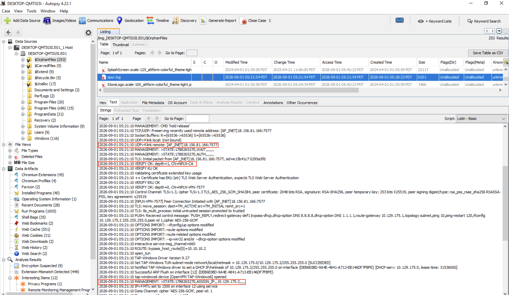

From this logfile, we can determine that the user established a connection to the VPN server at `18.156.81.166` on port `7577` <span style="color: #9FEF00;">**(Q1)**</span>. The subsequent certificate verification reveals the trusted certificate chain, with `CN=NPLN-CA` at `depth=1`, identifying **NPLN-CA** as the Certificate Authority <span style="color: #9FEF00;">**(Q2)**</span>.

After the TLS connection is successfully established, the VPN server provides the client's network configuration. The client is assigned the IP address **10.129.175.2** <span style="color: #9FEF00;">**(Q3)**</span>, which is later confirmed by the `ASSIGN_IP` state in the connection log.

The Autopsy **Analysis Results** also show a section called **Interesting Items**, and browsing this reveals a subsection called **Remote Monitoring Management Programs**. Here, we found an unusual process: `tacticalrmm.exe`.

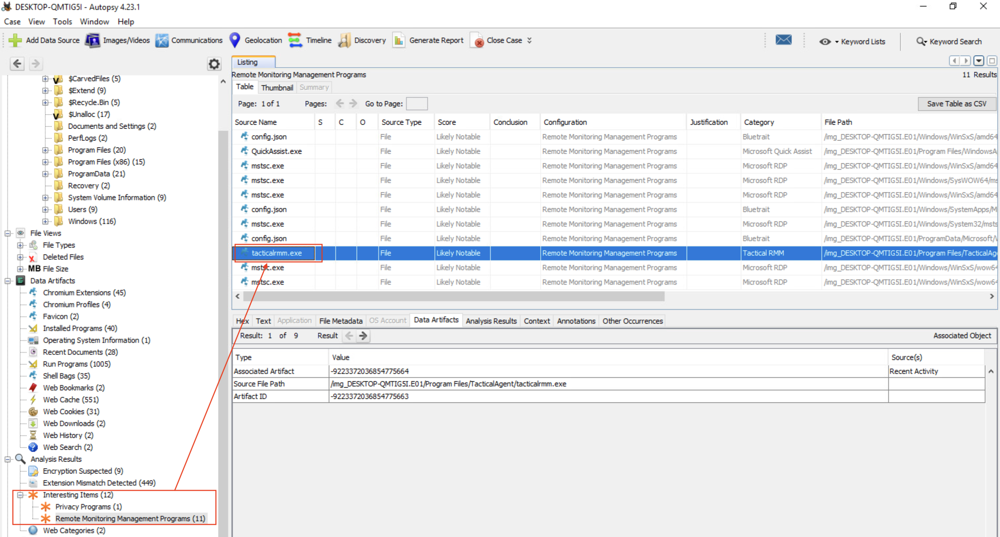

**Tactical RMM** is a free remote monitoring and management (RMM) platform with open source code that allows you to monitor and control computers from a single central dashboard. 

It is also listed in **Installed Programs**, where we can retrieve the installed agent version: `Tactical RMM Agent  v.2.11.0` <span style="color: #9FEF00;">**(Q4)**</span>.

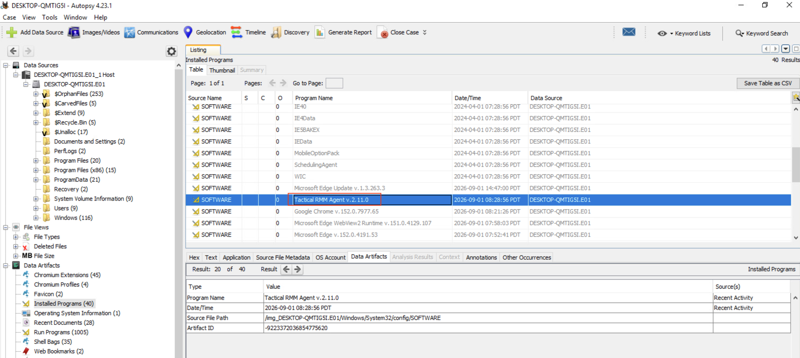

Double-clicking on the item opens the corresponding registry entry in the SOFTWARE hive. Here, we can find out more information about the agent, including the remote domain it connects to, `api.antimattercommunication.xyz` <span style="color: #9FEF00;">**(Q5)**</span>,and the authentication token used for registration, `98ec588da683c01820232943a6151e8e7772419b` <span style="color: #9FEF00;">**(Q6)**</span>.

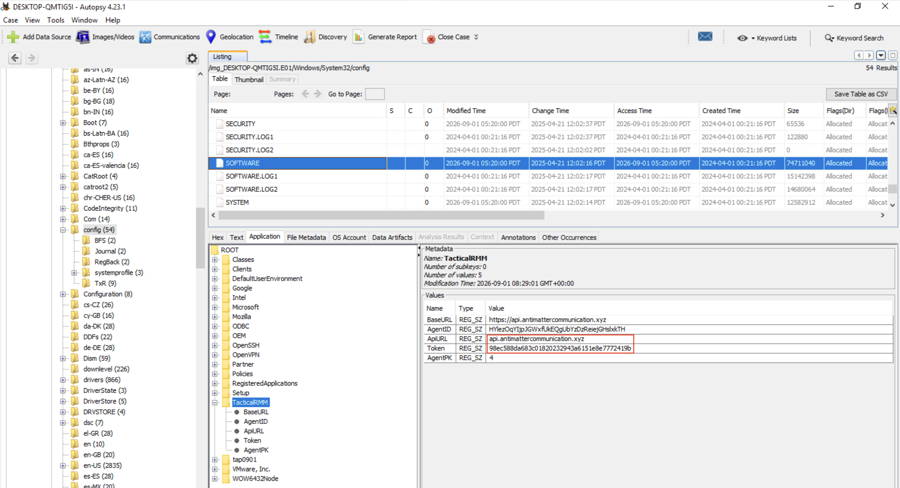

Once we have confirmed that **TacticalRMM** is installed, we can investigate to establish whether the criminals used it to execute commands on the jailer's PC. As the `agent.log` file in the TacticalRMM folder contains no information, we can try checking the Windows logs instead. We extracted both the **PowerShell Operational** and **Security** logs. The first is empty; the second instead contains something really interesting: `tacticalrmm.exe` spawned a `cmd.exe` process, which launched a `powershell` instance with an encoded command.

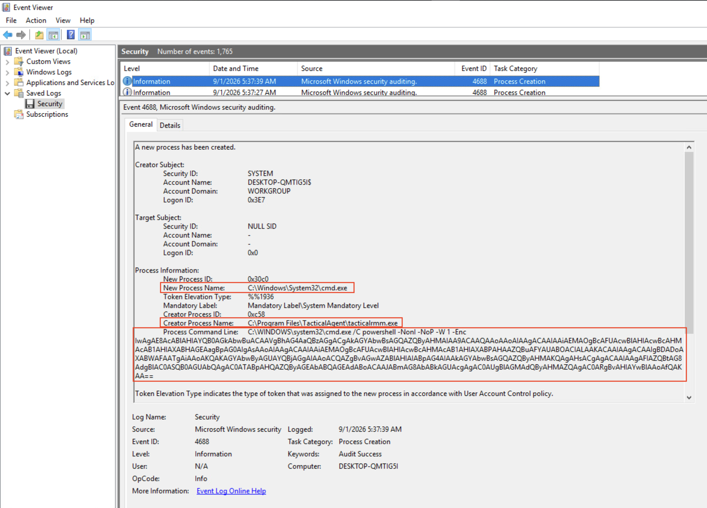

This is the actual script block once it has been decoded from Base64:

```powershell
# Operation Vanish
$folders = @(
    "C:\Users\spur\Gajim",
    "C:\Users\spur\OpenVPN",
    "C:\VPN"
)
foreach ($folder in $folders) {
    Remove-Item -LiteralPath $folder -Recurse -Force
}

```

The encoded command starts '**Operation Vanish**', which essentially removes three directories by executing the following PowerShell cmdlets: <span style="color: #9FEF00;">**(Q7)**</span>:

```powershell
Remove-Item -LiteralPath C:\Users\spur\Gajim -Recurse -Force
Remove-Item -LiteralPath C:\Users\spur\OpenVPN -Recurse -Force
Remove-Item -LiteralPath C:\VPN -Recurse -Force
```

The first cmdlet provides another important clue, informing us that the user was using **Gajim**, a well-known **XMPP** client. Considering that the folder has also been removed, we can search for traces in the **$OrphanFiles** folder again. 

We found the folder `UserData` here, which contains user-specific application data such as account/configuration information, local settings, caches and other data used by Gajim during operation. Especially, `Settings.sqlite` is a SQLite database used by Gajim to store user-specific configuration and account information. It may contain configured XMPP accounts, server details, authentication information, and also stored passwords or password-related data.

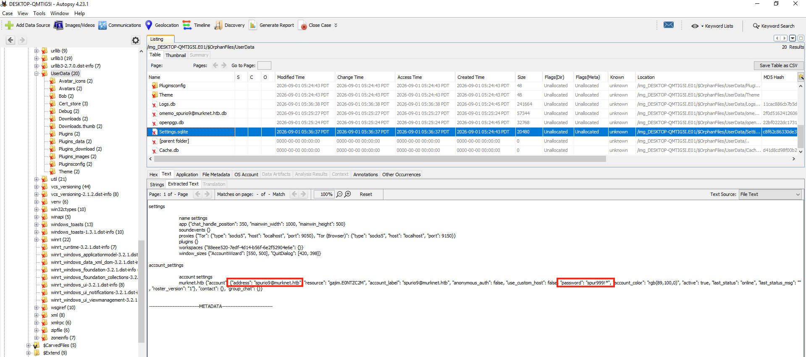

The user connected to the XMPP server using the JID `spurio9@murknet.htb` <span style="color: #9FEF00;">**(Q8)**</span> and the password `spur999!*`<span style="color: #9FEF00;">**(Q9)**</span>. 

Right now we have no clues about where to search to retrieve the full name of the jailer, so we focus our attention on Browsers, since they are most likely the only software that can contain this information.

In the "**Data Artifacts**" section of the Autopsy report related to web artifacts, there is nothing of interest except for a few searches performed by the Administrator user using the **Chrome** browser. However, there is nothing related to the user `spur`.

Next, let's analyze the contents of the `spur` user's Chrome `User Data` folder: `\Users\spur\AppData\Local\Google\Chrome\User Data\`: this is the root directory where Google Chrome stores all its per-user data. It contains every profile, setting, and cache belonging to the Windows user account.

Here we have the `Default` folder that corresponds to the default profile for Chrome, within this directory there are a lot of files, such as: 

- **Bookmarks**: Bookmarks
- **Cookies**: SQLite DB of cookies
- **History**: SQLite DB of visited URLs and downloads
- **Login Data**: SQLite DB of saved passwords
- **Preferences**: homepage, startup pages, extensions state, permissions
- **Web Data**: Autofill addresses/cards, autofill suggestions

and subfolders, such as:

- **Cache, Code Cache, GPUCache**: cached web content and compiled JavaScript 
- **Extensions**: installed extensions/apps (CRX contents)
- **Local Storage, Session Storage**: websites' local/session storage
- **IndexedDB**: websites' structured databases
- **Sessions**: tab/session restore data

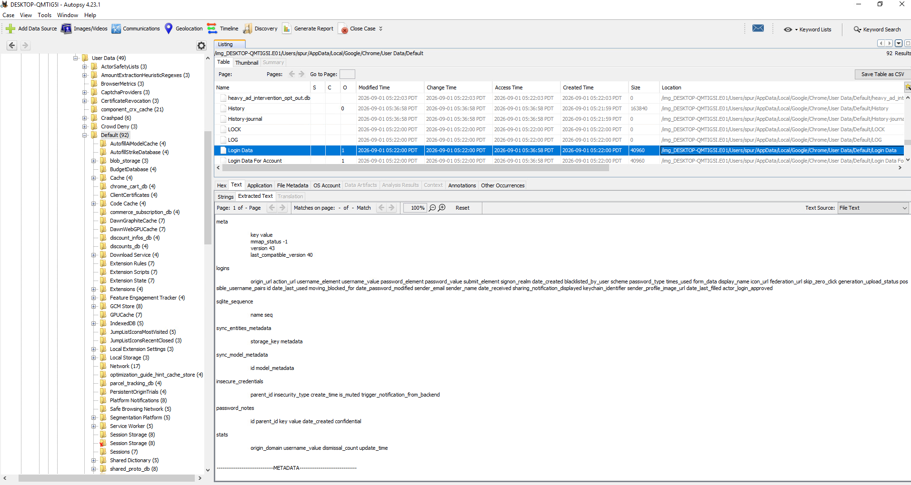

Since most of those files and folders are empty, we can assume that the user deleted their browsing data. However, we noticed that something interesting survived. 

In the **Sessions** folder, there are two `Sessions_*` and two `Tabs_*` files worth checking. We can analyze them manually or by using a script that parses the **SSNS (Session Service)** format like [this one](https://github.com/IRB0T/Chrome-History-SNSS-Parser).

We first need to mount the image, then we will pass the user's home folder to the script and this is the output:

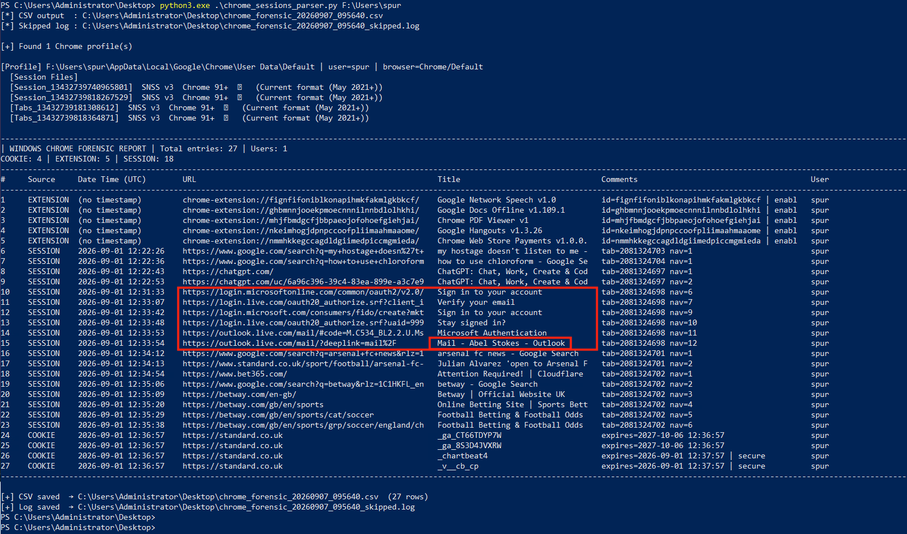

We can see the Chrome tabs that the user opened, including what appears to be a personal Outlook account with the user's full name: `Abel Stokes` <span style="color: #9FEF00;">**(Q10)**</span>.


## Questions

----------

1. **What are the remote address and port of the VPN server that the user connected to?**

	**Answer:** <span style="color: #9FEF00;">`18.156.81.166:7577`</span>


2. **What Certificate Authority (CA) issued the VPN client certificate?**

	**Answer:** <span style="color: #9FEF00;">`NPLN-CA`</span>


3. **What is the IP address assigned to the user by the VPN server?**

	**Answer:** <span style="color: #9FEF00;">`10.129.175.2`</span>


4. **It seems that the PC is remotely managed. What is the name and version of the installed remote management agent?**

	**Answer:** <span style="color: #9FEF00;">`Tactical RMM Agent v.2.11.0`</span>


5. **What is the domain the remote management agent connects to?**

	**Answer:** <span style="color: #9FEF00;">`api.antimattercommunication.xyz`</span>


6. **What is the remote management agent Authentication Token?**

	**Answer:** <span style="color: #9FEF00;">`98ec588da683c01820232943a6151e8e7772419b`</span>


7. **What is the first of the three commands executed in Operation Vanish?**

	**Answer:** <span style="color: #9FEF00;">`Remove-Item -LiteralPath C:\Users\spur\Gajim -Recurse -Force`</span>


8. **What is the account used to connect to the instant messaging server through the software previously identified?**

	**Answer:** <span style="color: #9FEF00;">`spurio9@murknet.htb`</span>


9. **What is the password for that account?**

	**Answer:** <span style="color: #9FEF00;">`spur999!*`</span>


10. **What is the full name of the jailer?**

	**Answer:** <span style="color: #9FEF00;">`Abel Stokes`</span>
