# <center>Holmes4-2026 Writeup</center>

-----------

<p align="center">

</p>
2026-09-10

Prepared by: CyberJunkie

Sherlock Author: CyberJunkie

Difficulty: <font color="Green">Easy</font>

## Description

```
In this challenge, players reconstruct a timeline and correlate artifacts to identify a USB drop attack, microphone and webcam hijacking, and sensitive information stored in cleartext on the system. The scenario is based on a USB drop attack executed by an insider threat to facilitate remote access to a sensitive system.

```

## Scenario

```
A trusted contractor's badge opened a door no one thought to watch. The new IT support hire was a fake employee, built by GRUNER's pipeline to look administratively boring and pass every check. Within his first few days in the building, he executed a USB drop attack, leaving a malicious USB at a junior minister's desk, disguised as a routine driver update for her laptop. She plugged it in, ran the package, and thought nothing of it. The device was not an update. It carried a listening post built by an operator who trades in patience and quiet rooms. Within minutes her microphone woke, her webcam blinked on, and her meetings began flowing to a relay near the river. Your job is to reconstruct the drop and the attack, and what the man who was never really there let slip through the wall.
```

## Artifacts Provided

Enter the artifacts provided along with their file hash here.

- Holmes4-2026.zip - SHA256: *E28211E14B9FF373D8047DBD51EB2B422C50CB94A1926BFD1274ADB4045A9605*

## Skills Learnt

* Windows Registry Forensics
* DFIR
* Timeline Analysis
* Tracking application activity
* USB Forensics

## Initial Analysis

----------

To begin the analysis, the password-protected ZIP file was unlocked using the password `hacktheblue`.

We are provided with a KAPE triage image. We will use the KAPE module "EZParser", which will parse most common Windows artifacts automatically and organize them into categories. In Module Source, we will select the root folder of our triage collection, and in Module Destination, we will select a folder where we want the parsed results to be stored. Then select !EZParser in the modules list. Click Execute, and most of the common artifact sources will be parsed.

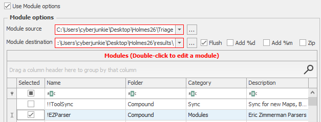

 Now we just have to analyze the CSV files of artifacts as needed. We will also use Registry Explorer to load and analyze registry keys that are not usually parsed by default in KAPE's module. Another tool we will use is called [sidr](https://github.com/strozfriedberg/sidr), which will be used to parse the Windows Search Index artifact.


## Questions

----------
1. **The rookie's first move was a planted USB. When did Clara Voss first connect the device Elias Venn left at her desk? (YYYY-MM-DD hh:mm:ss)**

	Whenever a USB flash drive, webcam, mouse, keyboard, or any other peripheral is connected to a Windows system, its information is recorded in the Windows Registry. Any mass storage device like an external HDD or USB has its information written under the **USBSTOR** key. The full path of this registry key is

	`HKEY_LOCAL_MACHINE\SYSTEM\CurrentControlSet\Enum\USBSTOR`
	
	The reason why this information is written in the Machine System hive rather than on a per-user basis is because the device is accessible by any user on the system, and the system is responsible for its global access.
	
	There is another key in the same location called USB. This key records information about peripherals like external hardware. We will mainly focus on the **USBSTOR** key only.
	
	Going into our results folder where KAPE stored the parsed results, we go under the registry folder and we can see multiple CSV files named after the key artifact they belong to.
	
	
	
	We will open the USBSTOR CSV file. We only have one entry under this key, proving that only one USB device was attached to the system.
	
	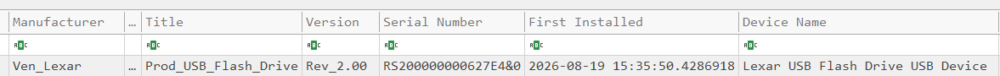
	
	We can see the vendor of the USB, its serial number, and when it was first installed. The same information can also be verified by going to the **USBSTOR** key after loading the SYSTEM hive in Registry Explorer.
	
	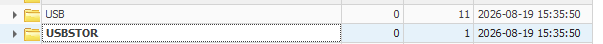
	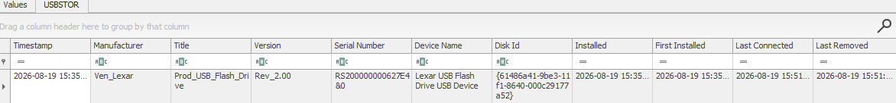
	
	**Answer:** <span style="color: #9FEF00;">`2026-08-19 15:35:50`</span>


2. **Every USB carries a serial scar. What serial number did the dropped device leave behind? (string)**

	We already found the answer to this question in our analysis of the **USBSTOR** key. One very important piece of information to mention here is that for devices whose second character is '&' in the serial number, it means that the serial number is not the actual hardware serial number but a virtual serial number assigned by the operating system to the device. In our case, there is no '&' in the second character, which proves that what we have identified is the actual hardware serial number, and this device's usage can be tracked across the network.

	**Answer:** <span style="color: #9FEF00;">`RS200000000627E4&0`</span>


3. **VON BORK's payload hid inside a fake update package Elias delivered. What is the full path of the payload? (full path of file, starting with drive letter)**

	We will start by checking ShellBags for the cvoss user, as this will show us when and which folders the user accessed on the USB device, if any. The parsed ShellBags for the cvoss user can be found under the FileFolderAccess folder in a file called cvoss_UsrClass.csv. ShellBags track folder access information, and this information is per user account, which makes user attribution easy.

	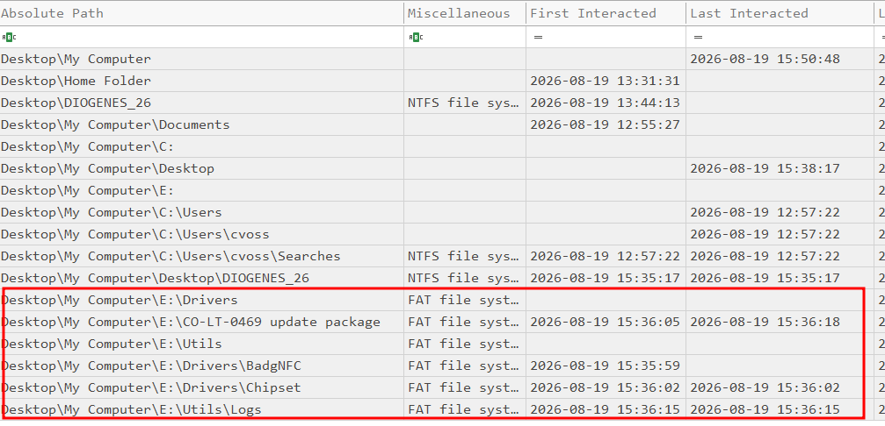
	
	We can confirm that the USB device was assigned drive letter E:, as in the ShellBags we can see all the locations under the E drive are shown as FAT file system, whereas other locations are listed as NTFS file systems, which is the default file system for modern Windows systems. We also get the first and last interacted timestamps of locations under the USB drive. A specific folder stands out: a folder named 'CO-LT-0469 update package', which confirms that this was a really well-crafted, planned attack on Voss. CO-LT-0469 is the hostname of the system that we are analyzing, and Elias specifically created a custom folder with the hostname so Clara would definitely open it. Next, we will analyze the UserAssist registry key, which is an artifact that proves execution of executables done via the Windows GUI (interactive access). Since Clara was not using the command line and only the Windows GUI, if the payload was executed, it should be in UserAssist. You can find its parsed result under the registry folder.
	
	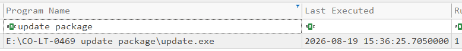
	
	We found the full path and name of the payload using the UserAssist registry key. We also found the timestamp when this file was executed.
	
	**Answer:** <span style="color: #9FEF00;">`E:\CO-LT-0469 update package\update.exe`</span>


4. **Believing it a routine update, Voss launched the spyware. At what exact timestamp did she execute the malicious package? (YYYY-MM-DD hh:mm:ss)**

	Already found the answer via UserAssist analysis.

	**Answer:** <span style="color: #9FEF00;">`2026-08-19 15:36:25`</span>


5. **DIOGENES tagged the USB with an asset name that surfaced as the device name on connection. What was it? (string)**

	This one is a bit tricky, as the true USB friendly name can not be found in the **USBSTOR** key and the triage collection does not contain the **Event Logs**. There is a registry key located at
	`HKEY_LOCAL_MACHINE\SOFTWARE\Microsoft\Windows Portable Devices\Devices`
	
	This key stores information like the friendly display name and sometimes the drive letter as well.
	
	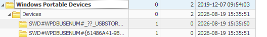
	
	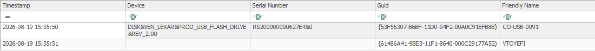
	
	We can correlate via the serial number or GUID that this indeed is the USB we are investigating. We can see its friendly name. The name also matches the naming convention of DIOGENES based on what we have seen so far.
	
	**Answer:** <span style="color: #9FEF00;">`CO-USB-0091`</span>


6. **Once C2 Access was live, VON BORK's listening post woke the microphone to spy on Voss's meetings. At what time did capture begin? (YYYY-MM-DD hh:mm:ss)**

	Windows keeps records of all microphone, location, webcam, and several other privacy-related permissions and access records. In Windows 10 systems and up to Windows 11 22H2, this information is stored in the User's Registry hive (NTUSER.dat) at the following location.

	`HKCU\SOFTWARE\Microsoft\Windows\CurrentVersion\CapabilityAccessManager\ConsentStore`
	
	For Windows 11 moving forward from 22H2, this information is stored in a SQLite database and retained for up to a month. This is for enhanced privacy reasons, as users would need to readjust the permissions each time the config is reset. We are using Windows 10, so we will navigate to the registry key.
	
	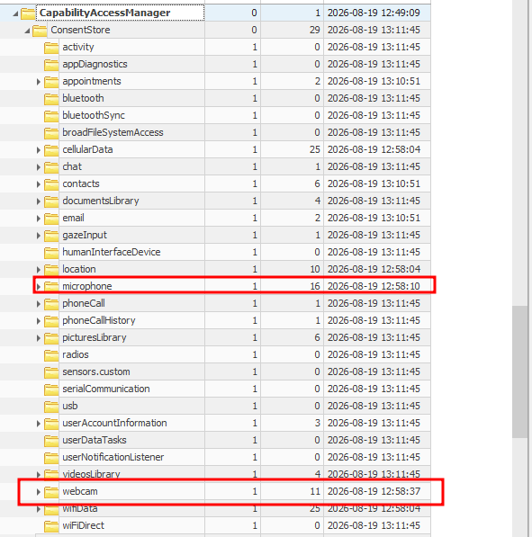
	
	Let us open the microphone key and expand the key "NonPackaged" since the malware was not a packaged application.
	
	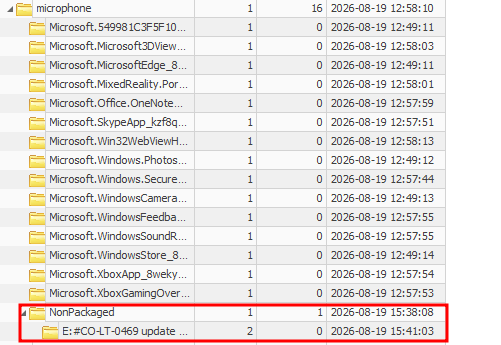
	
	We can see the full path of the payload that was executed from the USB drop attack. This artifact stores both start and stop time. This corresponds to when the file in question used the resource — in our case, when update.exe used the microphone on the system.
	
	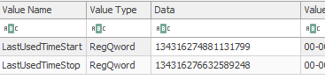
	
	The timestamp is in LDAP/Windows FileTime format and we can convert it online.
	
	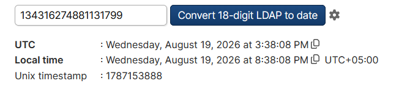
	
	
	
	**Answer:** <span style="color: #9FEF00;">`2026-08-19 15:38:08`</span>


7. **VON BORK mapped Voss's office through her webcam — who came and went, what lay on her desk. For how many seconds did the webcam stream? (number, such as 3, 17, or 4567)**

	Using the same CapabilityAccessManager key, we will now look for the payload under the webcam key.

	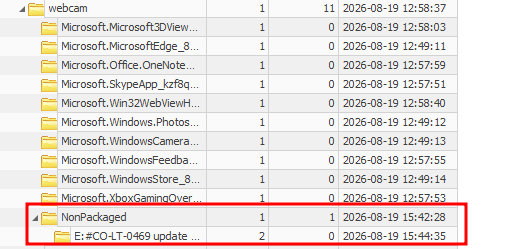
	
	We have to calculate the total time for which the webcam was used. We will convert both the start and stop times and calculate the difference between them.
	
	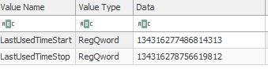
	
	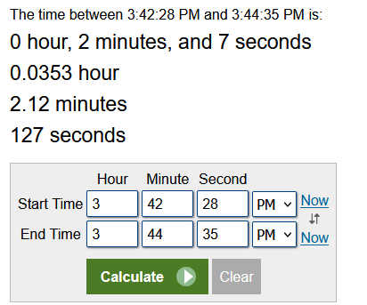
	
	So the attacker spied on the webcam for 127 seconds total. Either the webcam was being streamed, or the attacker continuously took snapshots via the webcam.
	
	**Answer:** <span style="color: #9FEF00;">`127`</span>


8. **The riverside relay drank Voss's secrets. How many decimal megabytes of outbound traffic flowed from the compromised machine to the C2? (***.******)**

	To identify the total outflow bandwidth, we will analyze the SRUM database. This can be found in the SRUMDatabase folder under the parsed results. Filter for the payload file, and we can see the total data received and sent by the payload.

	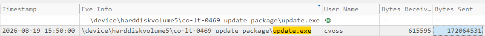
	
	We can see that the bytes sent are significantly larger than the data received. Converting the bytes to megabytes:
	
	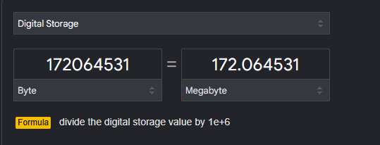
	
	Processes like browsers or legitimate file-sharing utilities make sense to have so much outflow bandwidth as per their use case. But an executable named update.exe sending so much data out of the machine is a red flag. Even if it was a legitimate update package, the outflow should never have exceeded the inflow, as in updates, files are downloaded to the system, not sent from the system.
	
	**Answer:** <span style="color: #9FEF00;">`172.064531`</span>


9. **Voss reviewed DIOGENES contractors NAPOLEON may now hunt. What set of credentials did the spying surface for a developer working on DIOGENES tickets? (username:password)**

	Checking the Jump Lists artifact (Automatic Destination), we find that cvoss accessed two files during the compromise window, especially during the time the attacker had already started their spying routine.

	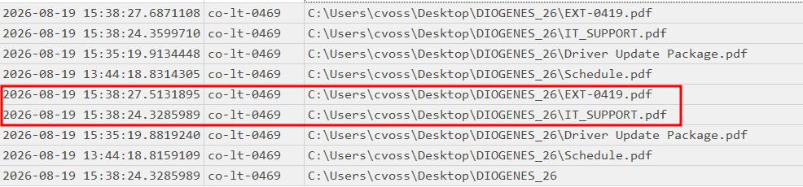
	
	Out of these two files, EXT-0419 looks like an asset or employee code. If these files were open during the spying routine, there is a high probability that the attacker took screenshots or took note of the information. To find the contents of this file, we will parse the Windows Search Index artifact using a tool called sidr. This artifact indexes partial content of different file formats, including PDFs as well. The Search Index database is stored in the path
	**C:\ProgramData\Microsoft\search\data\applications\windows\***
	
	The database is in EDB format. Usually after collection, the database is in a dirty state and needs repairing. We can use Windows Esentutl to repair the database and then parse it using sidr.
	
	`esentutl.exe /p "C:\Users\cyberjunkie\Desktop\Holmes26\Triage\C\ProgramData\Microsoft\search\data\applications\windows\Windows.edb"`
	
	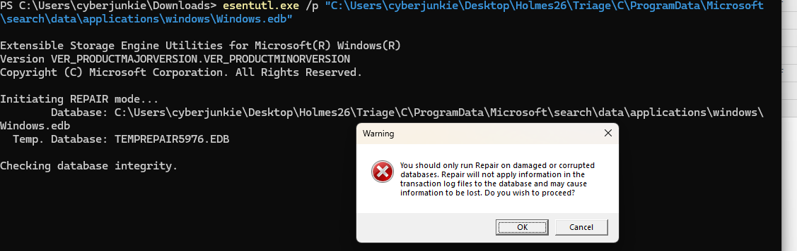
	
	Now we can use sidr to parse the database. The following is the format to use with the tool:
	
	
	
	`Sidr.exe -f csv -o "OuptutDirectory"  "Folder Location of Windows Search index database"`
	
	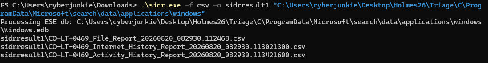
	
	We will have different types of results parsed out of this database. We are interested in the File_Report.
	
	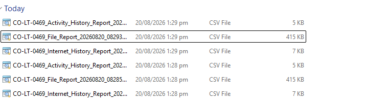
	
	After opening the CSV, we can filter on the file name we identified as of interest. Now look for a column named "Auto Summary". This will contain the partial content of the document in plaintext.
	
	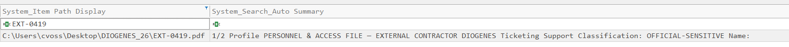
	
	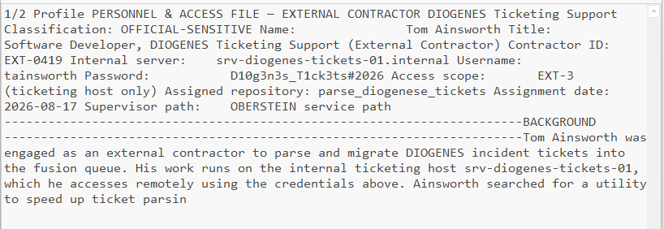
	
	Here we can see that the Employee ID is EXT-0419 and a software developer assigned to the DIOGENES Ticketing system named Tom Ainsworth. What makes this more critical is that we can find his set of credentials to an internal server. At this point in time, these credentials and information must be assumed compromised.
	
	**Answer:** <span style="color: #9FEF00;">`tainsworth:D10g3n3s_T1ck3ts#2026`</span>
