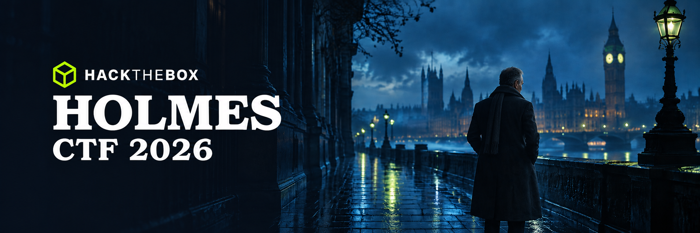

  

<h1 align="center">The Reichenbach Directive</h1>

  Watson vanishes. Holmes returns. Mycroft opens DIOGENES.

  <strong>17-21 September 2026</strong> · Defensive CTF · <a href="https://www.hackthebox.com/events/holmes-2026">Event page</a>

## Sherlocks

| # | Sherlock | Category | Difficulty | Description |
| :--: | :-- | :-- | :-- | :-- |
| 01 | [Silent Dividend](<Silent Dividend/README.md>) | Blockchain | Medium ⭐⭐⭐ | Settlement application and smart contract |
| 02 | [Bottle Out](<Bottle Out/README.md>) | SOC | Easy ⭐⭐ | Seized laptop and remote access infrastructure |
| 03 | [Whisper Chain](<Whisper Chain/README.md>) | Threat Intelligence | Medium ⭐⭐⭐ | XMPP communications and operator identities |
| 04 | [Paper Ghost](<Paper Ghost/README.md>) | DFIR | Easy ⭐⭐ | USB drop and endpoint activity |
| 05 | [Poisoned Branch](<Poisoned Branch/README.md>) | DFIR | Pending | Backdoored repository and temporary server |
| 06 | [Silent Passenger](<Silent Passenger/README.md>) | Pending | Hard ⭐⭐⭐⭐ | Brief pending |
| 07 | [Iron Feather](<Iron Feather/README.md>) | DFIR | Hard ⭐⭐⭐⭐ | Drone firmware and black-box record |
| 08 | [Borrowed Name](<Borrowed Name/README.md>) | Pending | Insane ⭐⭐⭐⭐⭐ | Active Directory incident across two domains |
| 09 | [Last Light](<Last Light/README.md>) | Pending | Insane ⭐⭐⭐⭐⭐ | Live system investigation and containment |

Previous edition: [Holmes 2025](https://github.com/hackthebox/holmes-2025)
