# <center>Holmes2026-3 - Whisper Chain - Writeup</center>

-----------

<p align="center">

</p>

2026-09-01

Prepared by:  achille

Sherlock Author: achille

Difficulty: <font color="orange">Medium</font>


## Scenario

```
The forensic investigation ended with more questions than answers. Among the recovered artifacts were traces of a much larger operation—one that appears to have been carefully orchestrated over a long period of time. Following those leads may reveal the group's plans, expose the people involved, and uncover what they are preparing next.
```


## Skills Learnt

* XMPP Protocol Analysis
* Threat Intelligence Gathering
* OSINT
* Adversary Profiling


## Investigation

----------

### Initial Analysis

We start by spawning the VM and taking note of its IP address, then we perform a basic `nmap` scan just to check the most common open ports.

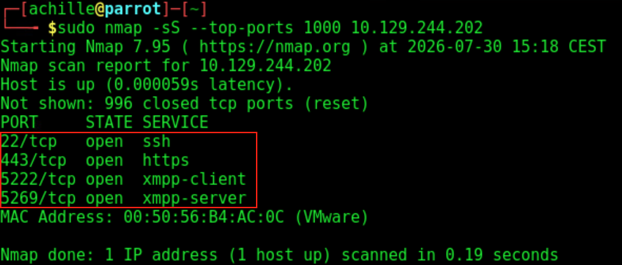

As expected, ports **5222** and **5269** are open, confirming that the VM is running an **XMPP** server. HTTPS port (**443**) is open too. Let's try now with a more aggressive scan.

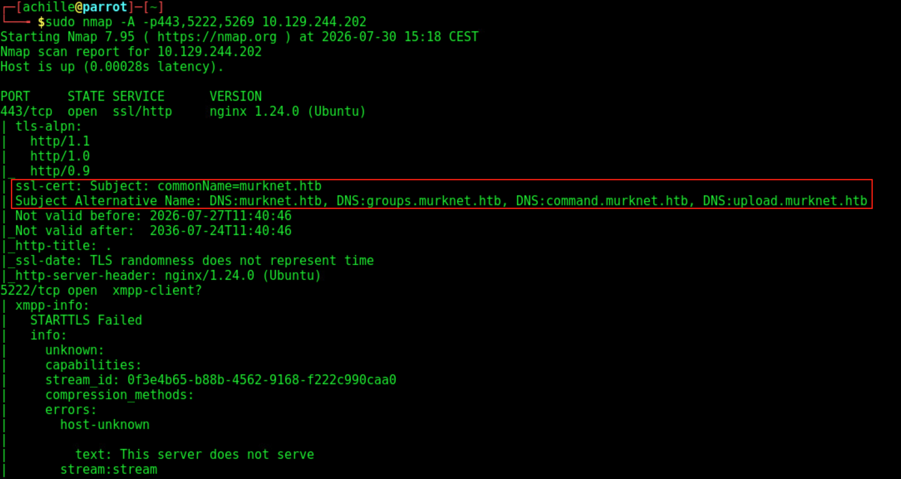

From the second `nmap` scan, we can see that the server is using an SSL certificate containing four Subject Alternative Names (SANs) (<span style="color: #9FEF00;">**Q1**</span>):

- `murknet.htb`
- `command.murknet.htb`
- `groups.murknet.htb`
- `upload.murknet.htb`

After adding these hostnames to our `/etc/hosts` file, we can browse to each of them. However, regardless of which hostname we use, we are always presented with the same HTTP landing page.

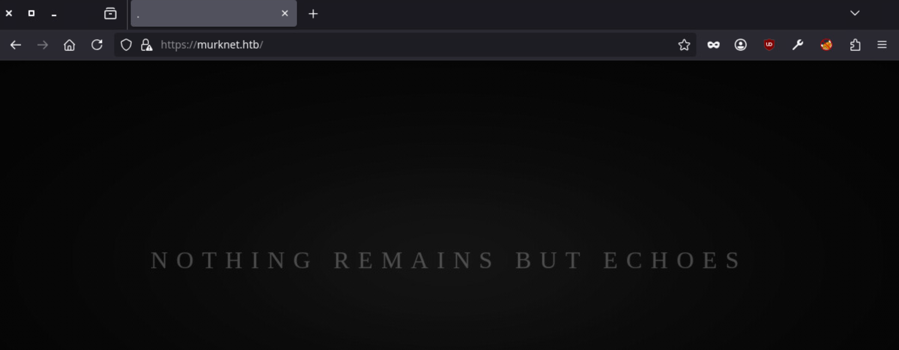

### XMPP Analysis

Let's point our attention to the XMPP server. We saw from the `nmap` scan that the In-Band Registration is advertised, so the server supports **XEP-0077** account registration, but we still don't know if the registration is completely free or restricted.

Let's try to create an account. We can use any XMPP client, we'll use **Psi+**, the development branch of Psi XMPP client, as it is very flexible. We try to create a new account on the server with the following credentials: `testaccount@murknet.htb:testaccount`. It worked, so the server allows for free registration.

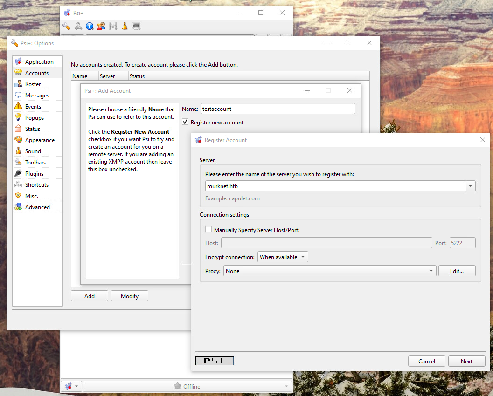

Now, let's see which XMPP services are enabled through Service Discovery

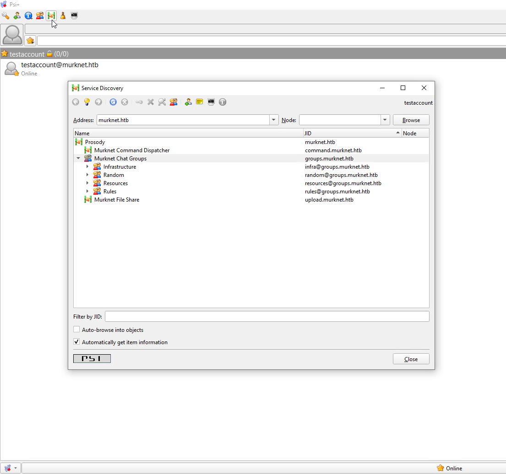

We can see that three services are running, corresponding to the Subject Alternative Names (SANs) identified previously:

- **command.murknet.htb** — Murknet Command Dispatcher
- **groups.murknet.htb** — Murknet Chat Groups
- **upload.murknet.htb** — Murknet File Share

Except for the first service, their purpose is fairly self-explanatory. **groups.murknet.htb** implements [XEP-0045: Multi-User Chat](https://xmpp.org/extensions/xep-0045.html), providing support for chat rooms, while **upload.murknet.htb** implements [XEP-0363: HTTP File Upload](https://xmpp.org/extensions/xep-0363.html), allowing users to upload and share files over HTTP through the XMPP server.

If we browse the Chat Groups, we can see that there are four public channels listed (<span style="color: #9FEF00;">**Q2**</span>):

- Infrastructure 
- Random
- Resources
- Rules

Let's join all of them.

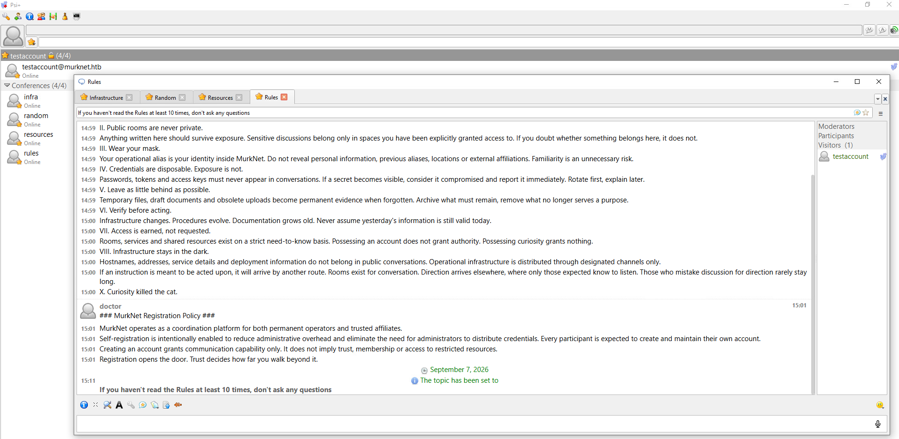

It is immediately evident that the XMPP server has [**XEP-0313: Message Archive Management**](https://xmpp.org/extensions/xep-0313.html) enabled, as the chat rooms are populated with a large number of archived messages. This extension allows clients to retrieve historical conversations stored by the server, making previously exchanged messages accessible even to users who join the room at a later time.

Our next step is to review the archived conversations in search of useful information. As a starting point, we can identify the users who actively participated in the various chat room discussions, as they are the most likely to reveal valuable intelligence or provide clues for further investigation.

| Nickname        | Notes                                                        |
| --------------- | ------------------------------------------------------------ |
| **doctor**      | Authored the rules in the `#rules` channel. Appears to be a senior member who occasionally provides guidance and reminders. |
| **rattlesnake** | Active in technical discussions, particularly around networking and infrastructure. |
| **venom**       | Frequently discusses software and custom tools. Appears to have a development background. |
| **timothy**     | Less experienced member who often asks questions and seeks advice from others. |
| **colonel**     | Rarely speaks, but his suggestions are generally acknowledged by the rest of the group. |
| **swissclock**  | Often discusses servers, maintenance, and infrastructure-related tasks. |
| **dang**        | Regularly shares technical resources, documentation, and useful links. |
| **snowwhite**   | Frequently shares articles and research material in the `#resources` channel. |

A first clue emerges from the **#resources** channel. Shortly after `rattlesnake` uploads a PDF document, `colonel` asks whether the metadata has been cleaned, prompting a discussion among several participants about the risk of leaking usernames and other identifying information through PDF metadata.

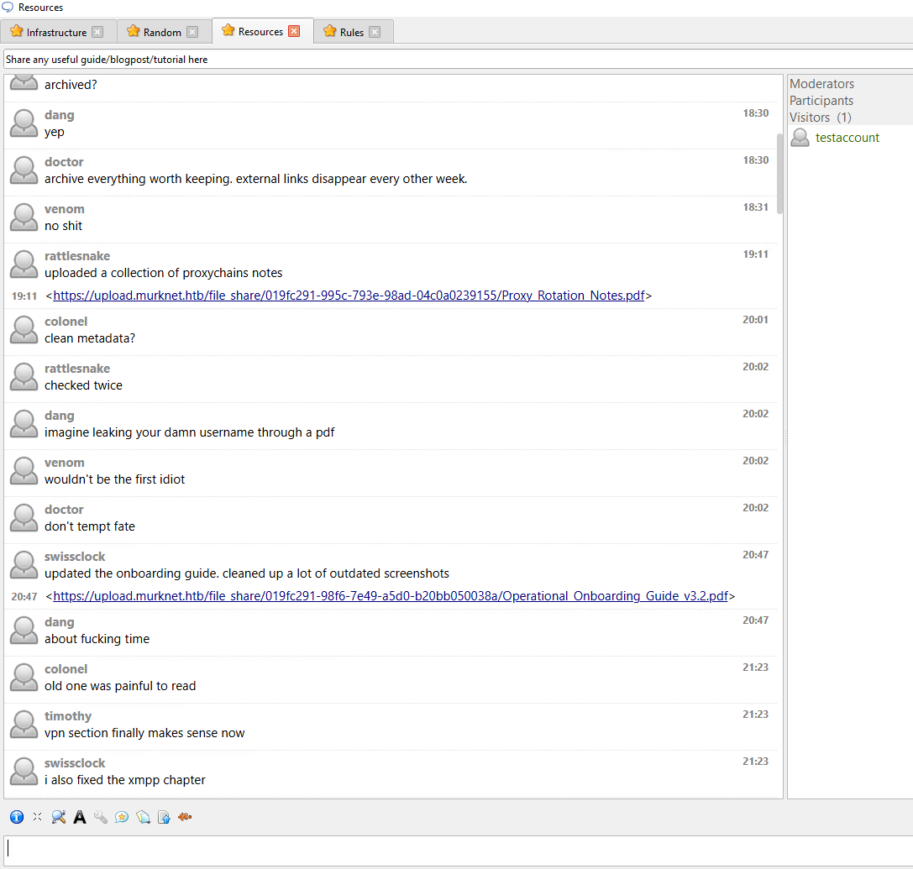

We begin by downloading and inspecting the document uploaded by `rattlesnake`, but the analysis does not reveal any useful information. We then turn our attention to the second PDF, this time uploaded by `swissclock`.

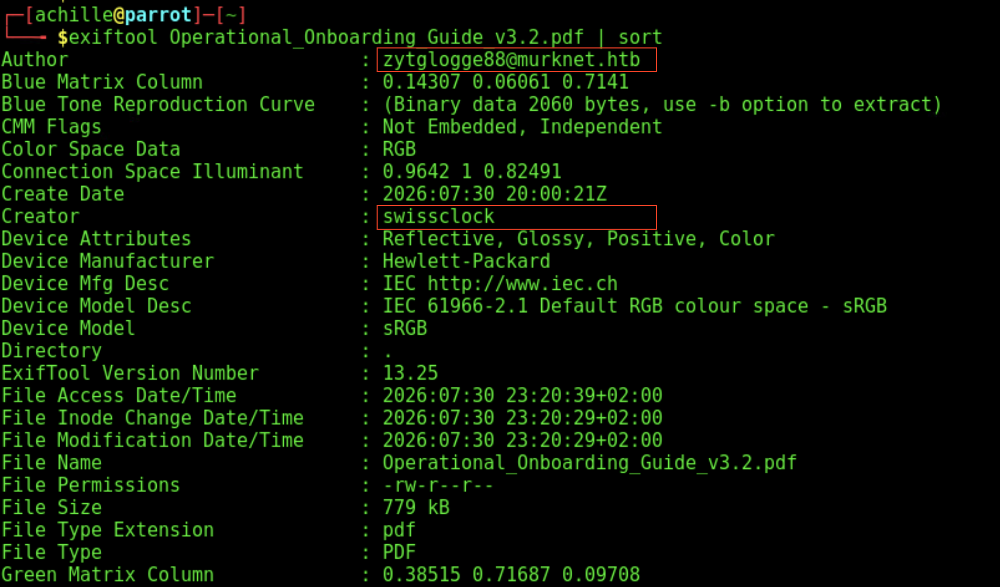

It seems that `swisslcock` instead didn't check the metadata of his upload, therefore leaking their own **XMPP JID**: `zytglogge88@murknet.htb`.

Another interesting piece of information comes from the **#infra** channel. During a conversation about old infrastructure and past operations, `rattlesnake` starts making fun of the group's old procedures and ends up posting some of the passwords that were previously used by APT members and affiliates. `doctor` immediately gets upset, telling `rattlesnake` to stop sharing that kind of information and warning everyone who might still be using those passwords to rotate their credentials immediately. `swissclock` simply replies, *"Will do soon"*.

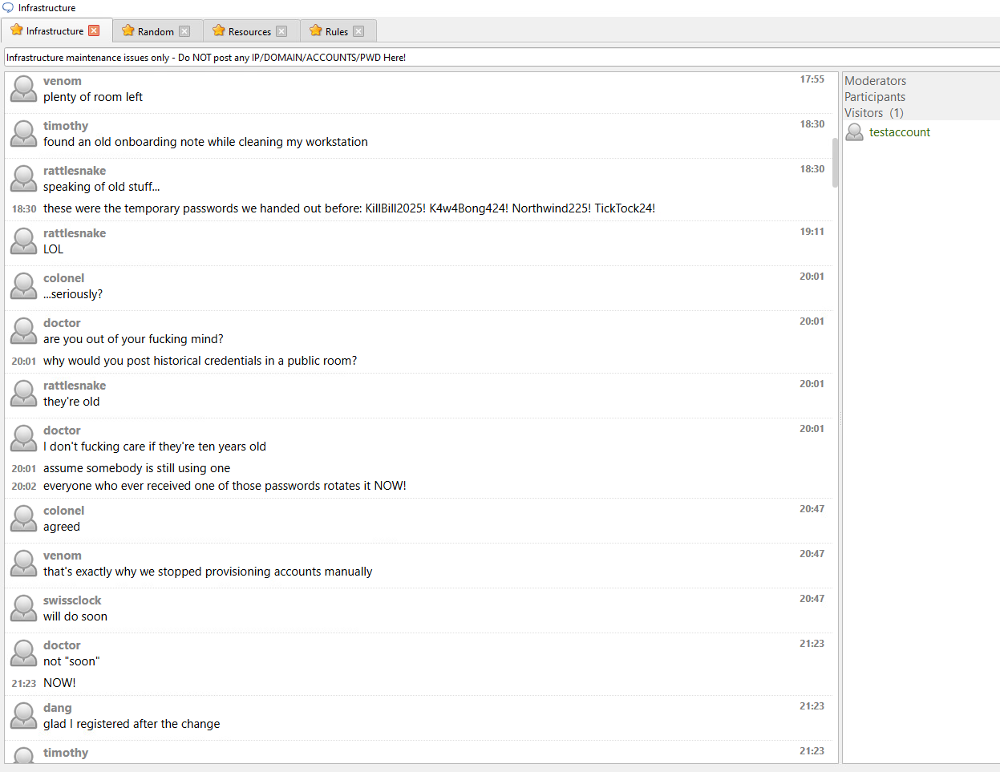

This exchange is particularly interesting because it suggests that some members may still be using old credentials. Since `swissclock` explicitly acknowledges the warning, the leaked passwords become good candidates to test against their account.

It turns out that `TickTock24!` is exactly the password that `swissclock` (`zytglogge88@murknet.htb`) is still using (<span style="color: #9FEF00;">**Q3**</span>). Once we connect with this new account, we have access to two new channels and two private chats:

- Operation Sparkling
- Operation Snatch
- Private chat with snake6288@murknet.htb (`rattlesnake`)
- Private chat with spurio9@murknet.htb (`spur`)

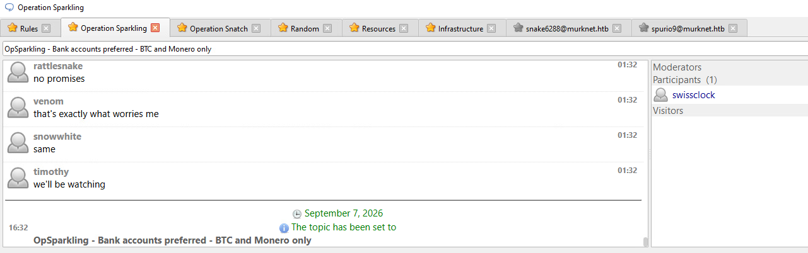

We can now start reviewing the discussions in the newly discovered channels. It quickly becomes clear that both **#op_sparkling** and **#op_snatch** are used by APT members and affiliates to plan and coordinate their illicit activities.

From the conversations in **#op_sparkling**, we learn that **Operation Sparkling** is an online campaign focused on stealing online banking credentials and cryptocurrency wallets, particularly Bitcoin (BTC) and Monero (XMR). In contrast, the discussions in **#op_snatch** reveal plans and operational details related to Watson's kidnapping, providing valuable context about how the operation was organized.

One detail that immediately stands out is that both channels contain several references to **"commands"** that are expected to arrive through a different route. Throughout the conversations, members and affiliates repeatedly remind each other to check this alternate source regularly so they do not miss new instructions.

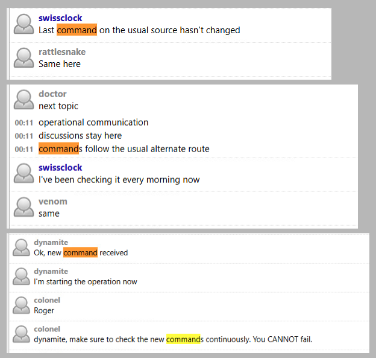

If we think back to the results of the Service Discovery, there is still one XMPP service that we have not investigated: **command.murknet.htb**. Given its name and description (Murknet Command Dispatcher) and the repeated references to incoming commands, it is highly possible that it is used to distribute operational instructions to the group's members.

Browsing this service with the `swissclock` account reveals that the user is **subscribed** to two different **nodes**, both named after the private channels we previously discovered. The presence of **nodes** and active **subscriptions** strongly suggests that `command.murknet.htb` is an [**XMPP PubSub**](https://xmpp.org/extensions/xep-0060.html) service used to distribute messages to subscribed members.

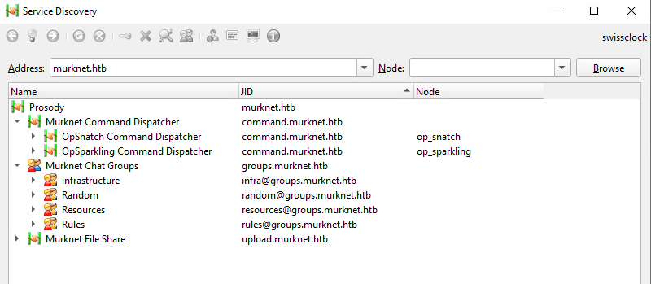

Let’s try interacting with the service using the **Python** `slixmpp` **library** to see what information we can retrieve. We create a very basic script that enumerates the available PubSub **nodes** and fetches the **items** published to each one.

```python
#!/usr/bin/env python3

import asyncio
import ssl
import slixmpp
from slixmpp.xmlstream import tostring

JID = "zytglogge88@murknet.htb"
PASSWORD = "TickTock24!"
HOST = "murknet.htb"
SERVICE = "command.murknet.htb"


class Reader(slixmpp.ClientXMPP):
    def __init__(self):
        super().__init__(JID, PASSWORD)

        self.enable_direct_tls = False
        self.enable_starttls = True
        self.enable_plaintext = False

        self.register_plugin("xep_0030") # Service Discovery plugin
        self.register_plugin("xep_0060") # PubSub plugin

        self.ssl_context = ssl.create_default_context()
        self.ssl_context.check_hostname = False
        self.ssl_context.verify_mode = ssl.CERT_NONE

        self.add_event_handler("session_start", self.start)

    async def start(self, _):
        self.send_presence()

        try:
            result = await self.plugin["xep_0060"].get_nodes(SERVICE)

            if isinstance(result, tuple):
                result = result[0]

            for entry in result["disco_items"]["items"]:
                node = entry[1] if isinstance(entry, tuple) else entry["node"]
                
                result = await self.plugin["xep_0060"].get_items(
                    SERVICE,
                    node,
                    max_items=100,
                )
                
								items = result["pubsub"]["items"]["substanzas"]
								print(f"\n=== Node: {node} - Items: {len(items)} ===")
                
                for item in items:
                    print(f"\n[+] Item: {item['id']}")
                    print(tostring(item.xml))

        except Exception as error:
            print(f"Error: {error}")

        self.disconnect()

async def main():
    xmpp = Reader()
    await xmpp.connect(host=HOST, port=5222)
    await xmpp.disconnected

asyncio.run(main())
```

Running the script shows that the `op_sparkling` node contains **8 items**, while `op_snatch` contains **10 items** . However, all of the retrieved items appear to be encrypted.

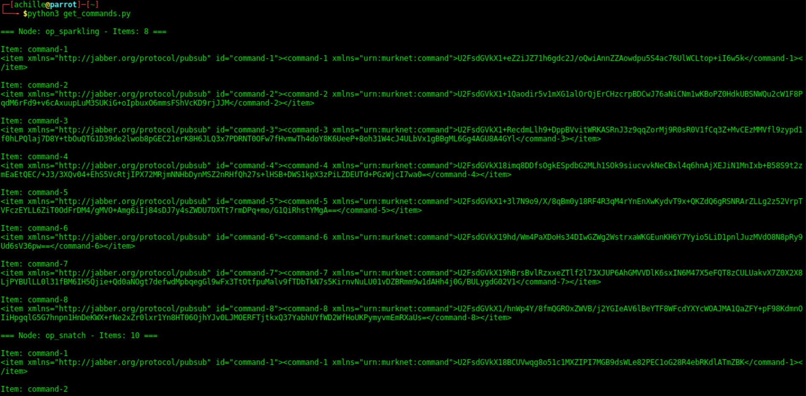

To understand how they can be decrypted, we need to investigate further. A useful lead appears in the **#op_sparkling** channel, where the participants discuss a blog post analyzing **BalanceRAT** and linking it to `rattlesnake`’s real identity. More importantly, the post also includes a **leaked decryptor**, which may be the key to recovering the contents of the PubSub items.

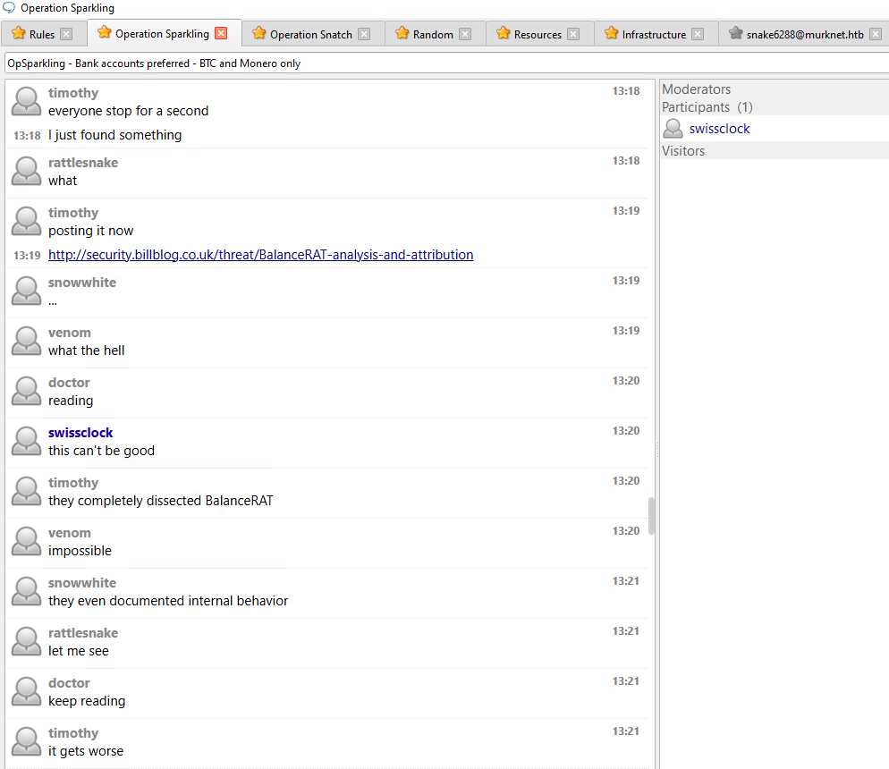

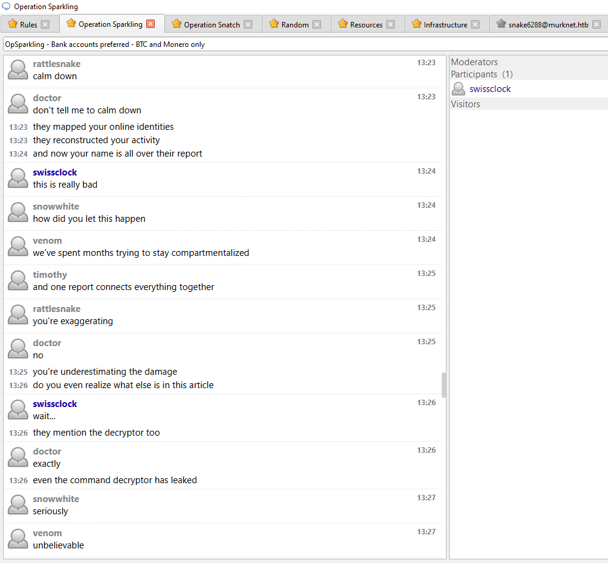

However, when we try to open the blog post at `http://security.billblog.co.uk/threat/BalanceRAT-analysis-and-attribution`, the server returns an error. Fortunately, searching for the page in the **Wayback Machine** reveals that an archived copy is still available.

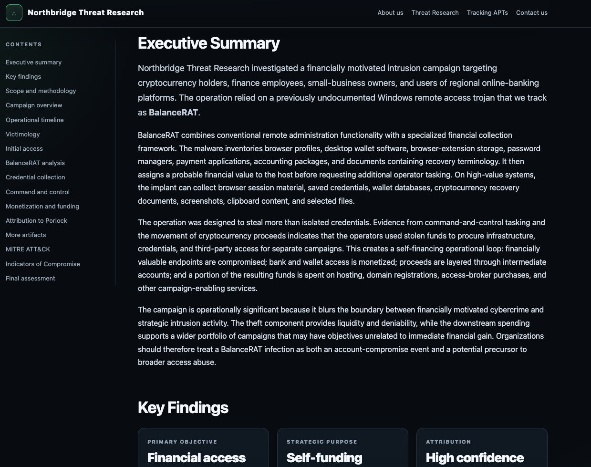

The blog post provides an in-depth analysis of **BalanceRAT**, the malware previously mentioned in the **#op_sparkling** channel. Through a combination of pivoting techniques and several operational security (OpSec) mistakes, the author is able to link `rattlesnake` to another online handle, **Porlock**, which ultimately leads to the disclosure of their real identity. (<span style="color: #9FEF00;">**Q4**</span>)

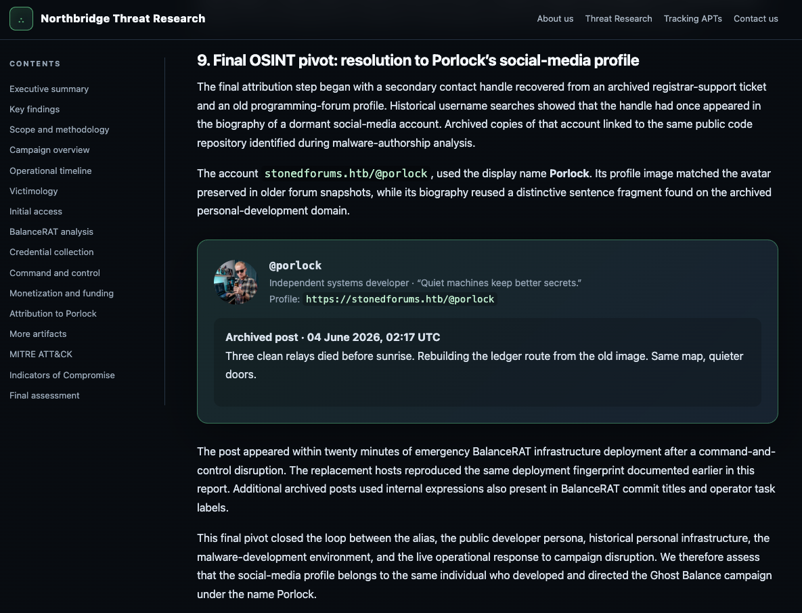

More importantly for our investigation, the **More artifacts** section includes a decryptor script. The script itself is fairly straightforward: it accepts an input string, decodes it from Base64, and then decrypts the resulting data using a hardcoded key: `BLACKFENLOTTE`. 

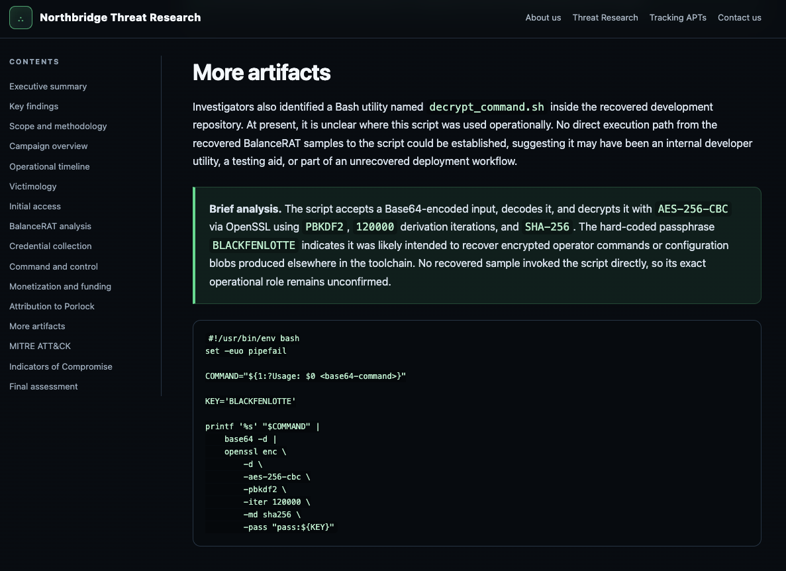

Let’s try using the leaked decryptor on the encrypted PubSub items recovered earlier. We first extract the encrypted strings from each node and save them into separate files, then run the decryptor against every line.

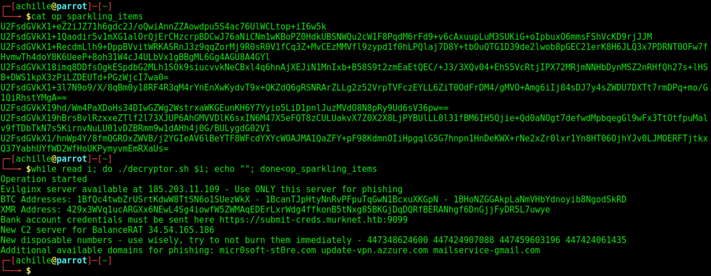

It works for `op_sparkling`, allowing us to recover all the commands distributed through its encrypted PubSub node. (<span style="color: #9FEF00;">**Q5**</span>)

```
Operation started
Evilginx server available at 185.203.11.109 - Use ONLY this server for phishing
BTC Addresses: 1BfQc4twbZrUSrtKdwW8TtSN6o1SUezWkX - 1BcanTJpHtyNnRvPFpuTqGwN1BcxuXKGpN - 1BHoNZGGAkpLaNmVHbYdnoyib8NgodSkRD
XMR Address: 429x3WVq1ucARGXx6NEwL4Sg4iowfW5ZWMAqEDErLxrWdg4ffkonB5tNxg85BKGjDqDQRfBERANhgf6DnGjjFyDR5L7uwye
Bank account credentials must be sent here https://submit-creds.murknet.htb:9099
New C2 server for BalanceRAT 34.54.165.186
New disposable numbers - use wisely, try to not burn them immediately - 447348624600 447424907088 447459603196 447424061435
Additional available domains for phishing: micr0soft-st0re.com update-vpn.azzure.com mailservice-gmail.com
```

However, when we repeat the same process with the encrypted items from `op_snatch`, the decryptor returns an error (`805DD1F901000000:error:1C800064:Provider routines:ossl_cipher_unpadblock:bad decrypt:providers/implementations/ciphers/ciphercommon_block.c:107`). 

We therefore need to dig deeper into the archived conversations. Shortly after the discussion about the leaked decryptor, `rattlesnake` says that the incident is not a major problem because the encryption key can simply be rotated and the new one will be shared with everyone through private messages.

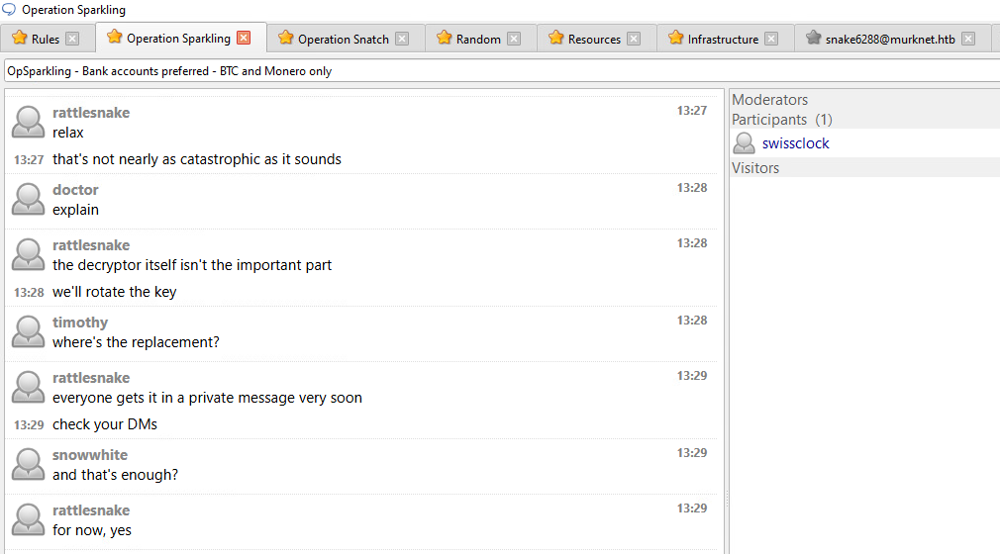

This leads us to review the private conversation between `swissclock` and `rattlesnake`. Unfortunately, **Psi+** doesn't automatically load archived private messages like it does for group chats. Therefore, we must use a different XMPP client, or we can create a quick Python script that uses the Slixmpp library:

```python
import asyncio
from getpass import getpass
import slixmpp

ME = "zytglogge88@murknet.htb"
PEER = "snake6288@murknet.htb"

class MAM(slixmpp.ClientXMPP):
    def __init__(self):
        super().__init__(ME, getpass("Password: "))
        self.register_plugin("xep_0313")
        self.add_event_handler("session_start", self.run)

    async def run(self, _):
        async for m in self["xep_0313"].iterate(with_jid=PEER, rsm={"max": 100}):
            r = m["mam_result"]
            f = r["forwarded"]
            s = f["stanza"]
            d = f.xml.find("{urn:xmpp:delay}delay")
            print(d.get("stamp") if d is not None else "?",
                  "->" if s["from"].bare == self.boundjid.bare else "<-",
                  s["from"].bare, s["body"])
        self.disconnect()

xmpp = MAM()
xmpp.connect()
asyncio.get_event_loop().run_until_complete(xmpp.disconnected)
```

After running the script and analyzing the messages, we discovered that the new key is: `SHALLOWBLUE`.

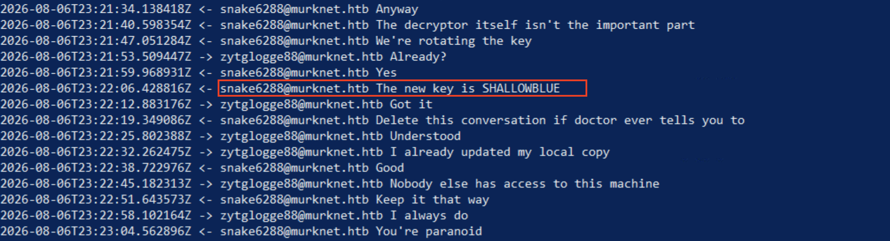

After replacing the old key in the decryptor with `SHALLOWBLUE` and running it again against the encrypted PubSub items from `op_snatch`, the decryption succeeds, allowing us to finally recover all the commands sent through the node. (<span style="color: #9FEF00;">**Q7**</span>)

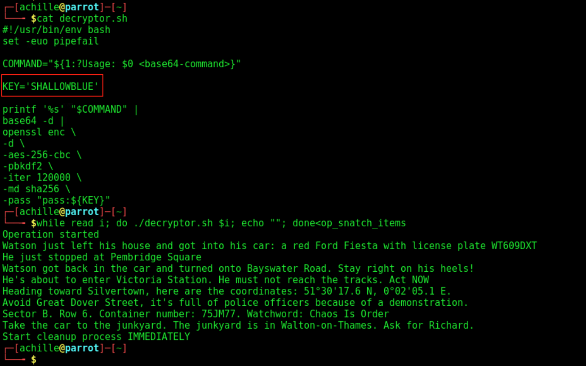

```
Operation started
Watson just left his house and got into his car: a red Ford Fiesta with license plate WT609DXT
He just stopped at Pembridge Square
Watson got back in the car and turned onto Bayswater Road. Stay right on his heels!
He's about to enter Victoria Station. He must not reach the tracks. Act NOW
Heading toward Silvertown, here are the coordinates: 51°30'17.6 N, 0°02'05.1 E.
Avoid Great Dover Street, it's full of police officers because of a demonstration.
Sector B. Row 6. Container number: 75JM77. Watchword: Chaos Is Order
Take the car to the junkyard. The junkyard is in Walton-on-Thames. Ask for Richard.
Start cleanup process IMMEDIATELY
```

Further analyzing the `op_snatch` messages provides more insight into the structure of the APT and the roles of each member. For example, it is clear that the person using the handle `dynamite`(**<span style="color: #9FEF00;">Q6</span>**) is the one who physically kidnapped Watson and drove him to the secret location.

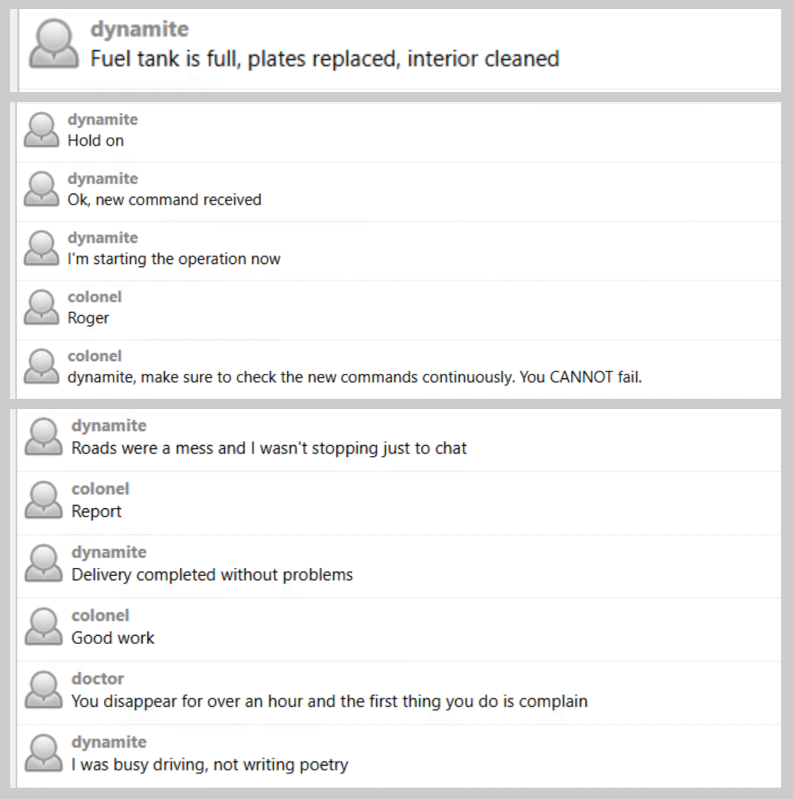

At this point, we have recovered all the encrypted information exchanged through the PubSub service and we have a clear picture of the operations. 

The only remaining clue is a new notification received during the investigation: `swissclock` has been invited to join another private channel: **Operation Dominance**.

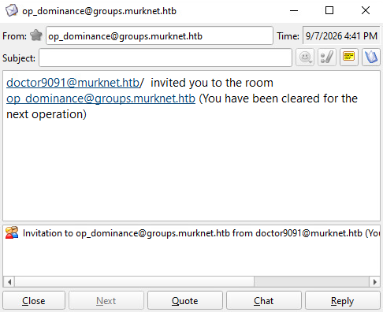

After accepting the invitation, we reviewed the archived conversations and quickly realized that this was a newly established operation. The discussions revealed that this would be the most important operation yet, with the objective of infiltrating **DIOGENES**. (**<span style="color: #9FEF00;">Q8</span>**)

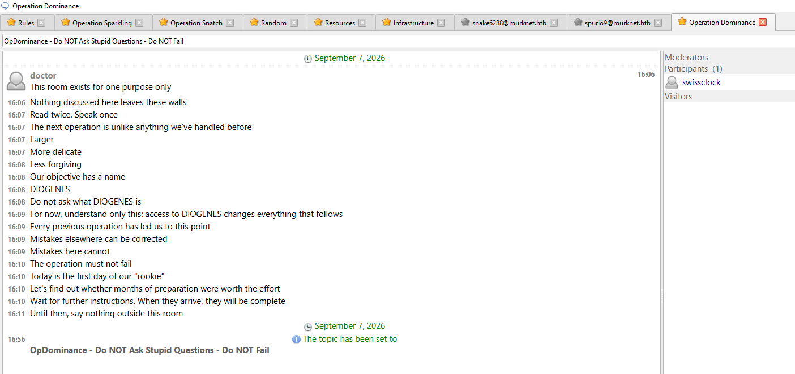


## Questions

----------
1. **List all Subject Alternative Names present in the server's TLS certificate. Report the primary hostname first, followed by the remaining SANs in alphabetical order.**

	**Answer:** <span style="color: #9FEF00;">`murknet.htb,command.murknet.htb,groups.murknet.htb,upload.murknet.htb`</span>


2. **List the names of all public channels available on the XMPP server, sorted alphabetically.**

	**Answer:** <span style="color: #9FEF00;">`Infrastructure,Random,Resources,Rules`</span>


3. **Investigate the conversations to find the credentials of one of the APT members.**

	**Answer:** <span style="color: #9FEF00;">`zytglogge88@murknet.htb:TickTock24!`</span>


4. **What is the URL of the social media account used by one of the APT members?**

	**Answer:** <span style="color: #9FEF00;">`https://stonedforums.htb/@porlock`</span>


5. **What is the XMR wallet used in the first operation?**

	**Answer:** <span style="color: #9FEF00;">`429x3WVq1ucARGXx6NEwL4Sg4iowfW5ZWMAqEDErLxrWdg4ffkonB5tNxg85BKGjDqDQRfBERANhgf6DnGjjFyDR5L7uwye`</span>


6. **What is the nickname of the APT affiliate who kidnapped Watson?**

	**Answer:** <span style="color: #9FEF00;">`dynamite`</span>


7. **Where has Watson been kidnapped?**

	**Answer:** <span style="color: #9FEF00;">`Victoria Station`</span>


8. **What is the name of the latest operation that the APT is planning, and what is its objective?**

	**Answer:** <span style="color: #9FEF00;">`Operation Dominance,DIOGENES`</span>

